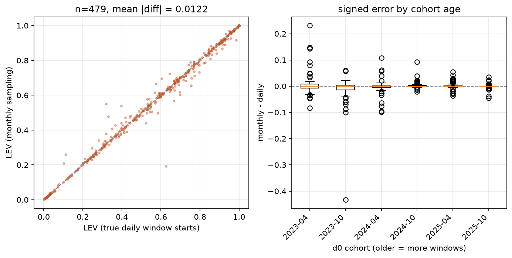

# lev-eval — Phase 1

Empirical evaluation of NIST's LEV metric (CSWP 41, Mell & Spring, May 2025):
are LEV probabilities calibrated against observed CISA KEV appearance?

## Setup

Python **3.14.6**. Exact pinned versions in [requirements.lock](requirements.lock);
`requirements.txt` holds the unpinned direct dependencies.

    python -m venv .venv && .venv/bin/pip install -r requirements.lock

## Reproducing

    make fetch       # populate cache/ from the network (once, ~1.5 GB)
    make reproduce   # regenerate every table and figure, offline, in order

Input provenance — hashes, release tags, retrieval dates, record counts — is
pinned in [DATA_SNAPSHOT.md](DATA_SNAPSHOT.md). `cache/` is gitignored.

Every script is standalone and everything downloaded is cached under `cache/`
(gitignored); re-runs never re-download.

    python data/download_epss.py     # ~67 monthly EPSS snapshots, ~130 MB
    python data/download_kev.py      # CISA KEV catalog
    python models/lev.py             # self-check on a hand-computed example
    python analysis/validate.py      # Task 4: reproduce CSWP 41 Table 5
    python analysis/calibration.py   # Task 5: reliability diagram -> figures/
    python analysis/reconcile.py     # Task A: Task 4 vs Task 5 population check
    python analysis/dn_sweep.py      # Task B': LEV vs analysis date -> figures/
    python analysis/epss_drift.py    # Task C'.1: organic vs retraining drift
    python analysis/version_normalize.py  # Task C'': version-normalized LEV
    python analysis/plateau.py       # Task C: plateau fit + c-drift test
    python analysis/top_bucket.py    # Task D: top-bucket stratification
    python analysis/vendor_ceiling.py # Task F: vendor-ceiling bound
    python analysis/leakage.py       # circularity check: EPSS uses KEV as a feature

## Status

| Task | File | State |
|---|---|---|
| 1 EPSS download | `data/download_epss.py` | done |
| 2 KEV download | `data/download_kev.py` | done |
| 3 LEV / LEV2 | `models/lev.py` | done |
| 4 Table 5 check | `analysis/validate.py` | **PASS** |
| 5 Calibration | `analysis/calibration.py` | done |

### Task 4 result (dn = 2025-03-01, 67 monthly snapshots)

| Published since | NIST Table 5 | ours (LEV) | ours (LEV2) | rel. err |
|---|---|---|---|---|
| 2023-03-07 | 0.015 | 0.0162 | 0.0161 | +8% |
| 2022-02-04 | 0.047 | 0.0479 | 0.0463 | +2% |
| 2021-04-14 | 0.087 | 0.0838 | 0.0832 | -4% |
| all CVEs (no version restriction) | 0.146 | 0.1299 | 0.1307 | -11% |

All four rows pass. The "all" row keeps the pre-archive corpus (it is not a
publication-date row) but still applies the backfill correction — without it
the row reads 0.2549 (+75%). See threat 7.

### Task 5 result (dn = 2026-08-01, 105,250 CVEs, 495 in KEV, base rate 0.0047)

95% Wilson score intervals (chosen over bootstrap: several buckets hold 7-24
KEV hits, where the normal approximation undercovers and a bootstrap of a
near-zero proportion just resamples the same few successes).

| bucket | n | predicted | observed | 95% Wilson | in KEV | obs/pred |
|---|---|---|---|---|---|---|
| [0.0, 0.1) | 90599 | 0.0264 | 0.0003 | 0.0002-0.0004 | 24 | 0.0100 |
| [0.1, 0.2) | 5802 | 0.1374 | 0.0050 | 0.0035-0.0072 | 29 | 0.0364 |
| [0.2, 0.3) | 2031 | 0.2446 | 0.0089 | 0.0056-0.0140 | 18 | 0.0362 |
| [0.3, 0.4) | 1166 | 0.3468 | 0.0154 | 0.0098-0.0243 | 18 | 0.0445 |
| [0.4, 0.5) | 869 | 0.4497 | 0.0184 | 0.0114-0.0297 | 16 | 0.0409 |
| [0.5, 0.6) | 702 | 0.5488 | 0.0100 | 0.0048-0.0204 | 7 | 0.0182 |
| [0.6, 0.7) | 564 | 0.6502 | 0.0213 | 0.0122-0.0368 | 12 | 0.0327 |
| [0.7, 0.8) | 492 | 0.7493 | 0.0386 | 0.0249-0.0595 | 19 | 0.0515 |
| [0.8, 0.9) | 435 | 0.8494 | 0.0414 | 0.0263-0.0645 | 18 | 0.0487 |
| [0.9, 1.0) | 2590 | 0.9866 | 0.1290 | 0.1166-0.1424 | 334 | 0.1307 |

Brier 0.03729, ECE 0.07633, mean predicted / observed = 17.2x.

**Only 2 of 9 adjacent-bucket differences survive Holm-corrected Fisher exact
tests**: [0.0,0.1) vs [0.1,0.2) and [0.8,0.9) vs [0.9,1.0), both p < 0.0001.
The seven middle buckets are statistically indistinguishable from one another.
The [0.5, 0.6) dip is **noise** — 7 KEV hits in 702 CVEs, Wilson interval
overlapping both neighbours, Fisher p = 0.206 and 0.109. Do not interpret it.
LEV is monotone in the right direction but massively over-confident against
KEV. See threat 9 below before reading that as a miscalibration finding.

### Task C — plateau fit and the c-drift test (`plateau.py`)

WLS `observed = c x predicted` through the origin on buckets [0.1, 0.9),
weights = bucket n.

| variant | c | 95% CI | R2 | [0.0,0.1) departure | [0.9,1.0) departure |
|---|---|---|---|---|---|
| LEV_raw | 0.03969 | 0.0302-0.0492 | 0.840 | 0.25x, p=6.5e-18 (86% of CVEs) | 3.29x, p=5.9e-79 |
| LEV_norm | 0.06083 | 0.0529-0.0687 | 0.950 | 0.44x, p=9.9e-11 (91% of CVEs) | 2.31x, p=1.8e-43 |

Normalization tightens the plateau (R2 0.840 -> 0.950) and halves both
end-bucket departures, but neither end is on the line.

**Implied KEV completeness** (LEV_norm): 495 in KEV / c = 8,138 implied truly
exploited, against sum(LEV_norm) = 6,238 on the same population, a ratio of
0.77x. Implied completeness 6.1% (raw: 4.0%, 12,470 implied, ratio 0.68x).

**c drifts with `dn`** — the decisive test, on LEV_norm with KEV membership
restricted to `dateAdded <= dn`:

| dn | N | in KEV | c | 95% CI | R2 |
|---|---|---|---|---|---|
| 2024-02-01 | 11,335 | 58 | 0.15019 | 0.0218-0.2786 | -1.061 (fit fails) |
| 2024-08-01 | 23,496 | 127 | 0.18305 | 0.0726-0.2936 | -2.249 (fit fails) |
| 2025-02-01 | 45,375 | 198 | 0.19200 | 0.1197-0.2643 | +0.352 |
| 2025-08-01 | 60,934 | 288 | 0.09859 | 0.0685-0.1287 | +0.822 |
| 2026-02-01 | 86,899 | 406 | 0.07979 | 0.0574-0.1022 | +0.830 |
| 2026-08-01 | 105,250 | 495 | 0.06083 | 0.0529-0.0687 | +0.950 |

c falls 3.16x, monotonically across the four dates where the model fits, with
disjoint endpoint CIs. Trend -0.0488/yr, p = 0.0082 (all six dates, df=4) and
-0.0492/yr, p = 0.0864 (usable fits only, df=2). Six dates are swept rather
than the three specified, because three leave df=1.

**Interpretation:** KEV coverage should not track the analysis date, so a
falling c points at LEV error rather than ground-truth incompleteness — the
residual over-confidence is largely a *metric* problem and it grows with the
observation window, consistent with the convex `dn` sweep. See threats 26-27.

### Task D — top-bucket stratification (`top_bucket.py`)

2,332 CVEs at LEV_norm >= 0.9; 324 in KEV, 2,008 not. **Every feature tested
separates the two groups after Holm correction:**

| feature | test | median KEV | median non-KEV | p (Holm) |
|---|---|---|---|---|
| peak EPSS | Mann-Whitney | 0.9197 | 0.7022 | <1e-300 |
| days above EPSS 0.5 | Mann-Whitney | 456 | 184 | 5.5e-26 |
| CVE age (days) | Mann-Whitney | 699 | 852 | 5.3e-09 |
| CVSS v3 base | Mann-Whitney | 8.9 | 8.8 | 3.0e-04 |
| vendor | chi-square | - | - | 1.2e-15 |
| CWE | chi-square | - | - | 3.8e-14 |
| Exploit-DB entry | chi-square | - | - | 9.1e-07 |
| Metasploit module | chi-square | - | - | 7.1e-18 |

KEV rate by vendor inside this bucket ranges from **32.5% (Microsoft)** and
24.4% (Ivanti) down to 2.3% (XWiki) and 0% (unknown) — a 14x spread among CVEs
LEV scores identically. CVSS separates significantly but trivially in
magnitude (8.9 vs 8.8), so vendor prominence, not severity, is what tracks KEV
membership here.

**Error source #4 (visibility):** 380 of the 2,008 non-KEV CVEs (18.9%) have a
published Exploit-DB entry or Metasploit module, against 39.8% of the KEV
group. These have demonstrated exploit *availability* and no KEV entry.

**Normalization removes false positives.** Of the 343 CVEs demoted from the
top bucket by normalization, only 16 (4.66%) are in KEV, against 13.89% for
the retained bucket — 3.0x lower, Fisher p = 2.1e-07, odds ratio 0.303.

### Monthly-sampling error, measured (`sampling_error.py`)

479 CVEs, stratified by LEV_norm decile across 6 `d0` cohorts, compared
against LEV computed on true daily window starts (156 targeted daily files).

| statistic | value |
|---|---|
| population-weighted mean \|diff\| | 0.00228 (**3.9%** of cohort mean LEV) |
| unweighted mean \|diff\| on the sample | 0.01216 (2.1% of sample mean LEV) |
| median \|diff\| | 0.00350 |
| 90th percentile \|diff\| | 0.02997 |
| max \|diff\| | 0.43285 |
| mean signed difference | -0.00011 (unsigned: 46.6% over, 39.5% under) |
| crossings of 0.5 / 0.9 | 1.88% / 1.04% of sample |

By cohort age, showing drift accumulating with window count:

| d0 | windows | n | mean \|diff\| | max \|diff\| |
|---|---|---|---|---|
| 2023-04-01 | 40 | 88 | 0.02099 | 0.23108 |
| 2023-10-01 | 34 | 87 | 0.02004 | 0.43285 |
| 2024-04-01 | 28 | 82 | 0.01200 | 0.10736 |
| 2024-10-01 | 22 | 88 | 0.00497 | 0.09225 |
| 2025-04-01 | 16 | 74 | 0.00736 | 0.05418 |
| 2025-10-01 | 10 | 60 | 0.00448 | 0.04457 |

**Verdict: bounded and negligible.** 3.9% sits well below the 26.9%
version-mass effect and is nowhere near the multiplicative bounds. See
threats 1 and 18.

### Task F — vendor-ceiling bound on KEV completeness (`vendor_ceiling.py`)

At equal LEV, exploitation propensity is asserted equal, so the vendor spread
in KEV rate is observation probability. The best-observed stratum bounds it.

| bucket | n | in KEV | observed | ceiling | completeness | implied true |
|---|---|---|---|---|---|---|
| [0.0, 0.1) | 78,190 | 47 | 0.0006 | 0.0025 | 0.243 | 194 |
| [0.1, 0.2) | 2,383 | 21 | 0.0088 | 0.1212 | 0.073 | 289 |
| [0.9, 1.0) | 1,693 | 282 | 0.1666 | 0.3245 | 0.513 | 549 |

(top-decile ceiling; only three buckets have >= 3 vendor strata at n >= 30)

**Over-confidence progression** — each successive figure is a tighter *upper*
bound:

| bound | over-confidence |
|---|---|
| raw LEV vs observed KEV | 17.2x |
| version-normalized LEV vs observed KEV | 12.6x |
| normalized LEV vs vendor-ceiling implied rate (envelope) | **3.4x** |
| normalized LEV vs vendor-ceiling implied rate (top decile) | **4.1x** |

Methods agree to within 1.22x. Implied truly exploited 1,123-1,369 against 441
observed.

> **Superseded values.** An earlier run of this table reported **2.9x
> (envelope) and 5.5x (top decile)**. Those predate the binning fix in
> `vendor_ceiling.py` (README threat 40): `pd.cut(right=False)` had dropped
> every CVE with LEV exactly 1.0 — 132 of 441 KEV entries in this population,
> the most extreme predictions. **The correct values are 3.4x and 4.1x.** The
> correction also tightened agreement between the two estimators from 1.9x
> apart to 1.22x apart, which is the better reason to trust them. Do not cite
> 2.9x/5.5x. Tasks B and C were never affected — they bin through
> `calibration.reliability()`, which uses digitize-and-clip and conserves all
> 105,250 CVEs and all 495 KEV entries (verified, and now asserted). Vendor canonicalization (207 canonical names absorbing >1 raw
string, e.g. `tp link` <- 4 variants) moves completeness by **0.0%** — the
merge is immaterial to the estimate.

**Falsification passes, and in the useful direction.** Within the top bucket,
high-KEV-rate vendors score *lower* on every exploitation-signal feature:
days above EPSS 0.5 (122 vs 182, effect -0.213), CVSS (7.8 vs 8.8, -0.216),
peak EPSS (0.720 vs 0.769, -0.175). Public-exploit presence is higher but
small and not significant (18.5% vs 12.7%, p=0.16). A real-exploitation
explanation for the vendor spread would need the *opposite* sign, so the
spread is not explained by exploitation propensity. Only 2 high and 3 low
vendors clear n >= 30 in that bucket. See threats 35-37.

### Task C'' — version-normalized LEV (`version_normalize.py`)

Same cohort (105,250 CVEs), same `dn` = 2026-08-01.

| variant | mean LEV | sum | frac > 0.5 | frac > 0.9 |
|---|---|---|---|---|
| LEV_raw | 0.08103 | 8528.5 | 0.0454 | 0.0246 |
| LEV_norm | 0.05927 | 6237.8 | 0.0340 | 0.0222 |
| LEV_v3only (diagnostic) | 0.01098 | 1155.7 | 0.0045 | 0.0030 |

| metric | LEV_raw | LEV_norm |
|---|---|---|
| mean predicted / observed | 17.2x | **12.6x** |
| Brier | 0.03729 | 0.02880 |
| ECE | 0.07633 | 0.05456 |

**Verdict: partially shared.** Version mixing explains ~27% of the
over-confidence; a 12.6x gap remains. The calibration gap and the
version-mixing finding overlap but are not the same finding — both stand.

**Table 5 convergence at `dn` = 2026-08-01** — independent corroboration, since
the normalization is computed from EPSS percentiles alone and never sees these
published values:

| since | NIST | raw | norm | raw dev | norm dev | improvement |
|---|---|---|---|---|---|---|
| 2023-03-07 | 0.015 | 0.0594 | 0.0434 | 296% | 189% | 107pp |
| 2022-02-04 | 0.047 | 0.0855 | 0.0665 | 82% | 41% | 40pp |
| 2021-04-14 | 0.087 | 0.1095 | 0.0895 | 26% | **3%** | 23pp |
| all CVEs | 0.146 | 0.2627 | 0.2376 | 80% | 63% | 17pp |

Mean absolute deviation from NIST: **120.9% raw -> 74.1% normalized**, 39% of
the deviation removed, and **4 of 4 rows move toward NIST**. At `dn` =
2025-03-01 raw and norm are identical by construction — no window reaches the
v4 boundary.

### Task C'.1 — organic vs retraining EPSS drift (`epss_drift.py`)

| cohort | total rise | within-version drift | retraining steps | verdict |
|---|---|---|---|---|
| v3 | +0.01962 | +0.00706 (36%) | +0.01256 (**64%**) | retraining-dominated |
| v1/v2 | +0.01986 | +0.00586 (30%) | +0.01400 (**70%**) | retraining-dominated |

One-day step at the v4 switchover, same 13,552 CVEs: 0.00862 -> 0.02640
(3.06x). See threat 25 on why the switchover date is not the version string.

### Task B' — LEV vs analysis date (`dn_sweep.py`)

Fixed cohorts, `dn` swept monthly 2023-10-01 to 2026-08-01.

| cohort | n | mean LEV first -> last `dn` | shape (AIC) | within-regime shape | frac > 0.9 now -> 2028-01 |
|---|---|---|---|---|---|
| v3 (first EPSS 2023-03..09) | 13,685 | 0.0082 -> 0.1351 | linear (R2 0.952) | linear (R2 0.997) | 0.046 -> 0.070 |
| v1/v2 (first EPSS 2021-05..09) | 7,558 | 0.3082 -> 0.4075 | linear (R2 0.960) | linear (R2 0.999) | 0.098 -> 0.126 |

No deceleration in either cohort; month-over-month increments grow. Cohort
mean EPSS rises rather than decays. See threats 12-16.

## Threats to validity

Assumptions the implementation makes that CSWP 41 does not specify. Each is
marked with an `ASSUMPTION` / `PROXY` comment at the point it is made.

1. **Monthly, not daily, EPSS sampling — measured at 3.9%**
   (`download_epss.py`, quantified in `sampling_error.py`). NIST computes LEV
   over daily files. A 30-day window stride against ~30.44-day snapshot
   spacing drifts ~0.44 days per window, so by the 30th window the pipeline
   reads a score up to two weeks from the date the equation asks for.
   Measured against true daily window starts on **479 CVEs stratified by
   LEV_norm decile across 6 `d0` cohorts** (156 targeted daily files):
   population-weighted mean |difference| **0.00228, i.e. 3.9% of cohort mean
   LEV** (2.1% unweighted on the decile-stratified sample, whose mean LEV is
   0.577 rather than the cohort's 0.059). The error is **unsigned** — 46.6% of
   CVEs over-estimate, 39.5% under-estimate, mean signed difference -0.00011 —
   so it adds noise, not bias. Threshold crossings: 1.88% of the sample at
   0.5, 1.04% at 0.9. **Verdict: bounded and negligible** against the 26.9%
   version-mass effect and the 3.4-4.1x bound; the daily archive is not needed
   for the Phase 1 conclusions.
2. **Missing snapshot days** (`download_epss.py`). The archive is missing some
   days (e.g. 2024-12-01) and answers 403, not 404, for them. We slide forward
   up to 3 days.
3. **Next-available-date substitution** (`lev.py`). When a window start is not
   a date we hold, the next snapshot on or after it is used — what NIST's own
   implementation does, but far coarser here than with daily data.
4. **Forward-filled retirements** (`lev.py`). A CVE that disappears from a
   later snapshot (EPSS retires rejected/disputed CVEs) keeps its last score.
5. **LEV2 integration** (`lev.py`). Eq. 5 needs a score per day; each snapshot
   is held constant until the next, i.e. EPSS is assumed piecewise-constant
   between snapshots. It is not.
6. **Publication date proxy** (`validate.py`). We have no CVE publication
   dates; a CVE's first EPSS appearance stands in. CVEs present in the first
   snapshot are dropped as undatable.
7. **EPSS coverage backfills** (`validate.py`). EPSS periodically expands
   coverage retroactively — on 2022-02-04 (v2) the corpus jumped from 81k to
   168k CVEs, mostly old ones. Uncorrected this counts old CVEs as newly
   published and inflated the two older Table 5 rows by 3–4x. A CVE counts as
   a genuine new publication only if EPSS first scored it within one calendar
   year of its CVE-ID year. This drops CVEs legitimately published more than a
   year after their ID was reserved.
8. **Analysis date** (`validate.py`). LEV grows monotonically with the
   observation window, so Table 5 is only reproducible at roughly the paper's
   own analysis date. CSWP 41 does not state it; 2025-03-01 is used.
9. **KEV is a lower bound, not ground truth** (`calibration.py`). CISA lists
   only exploitation it confirms *and* prioritises for federal remediation.
   The 17.2x gap is an upper bound on LEV's over-confidence: an unknown share
   of it is KEV's incompleteness, not LEV's error. CSWP 41 says as much — LEV
   is explicitly designed to estimate exploitation that KEV *misses*, so this
   comparison measures the two sources' disagreement, not LEV's error alone.
   Phase 2 needs a second exploitation signal to separate them.
10. **Six months is an arbitrary censoring window** (`calibration.py`). KEV
   additions lag exploitation by an unbounded amount; 334 of the 495 observed
   KEV hits sit in the top bucket, so the top bucket's observed rate is the
   most sensitive number in the table to this choice.
11. **The Task 4 / Task 5 population gap was `dn`, not a filter bug**
   (`reconcile.py`). Mean LEV 0.016 vs 0.081 decomposes as 3.67x from moving
   the analysis date 2025-03-01 -> 2026-08-01 and 1.36x from the 6-month
   censoring filter. On the 68,318 CVEs in *both* populations, with the set
   held fixed, the `dn` shift alone moves the mean 6.62x. **Every calibration
   number in this repo uses the Task 5 population** (`dn` = latest snapshot),
   because KEV membership is observed through the present and LEV must be
   computed to the same date. `dn` = 2025-03-01 is used only to reproduce
   Table 5. Consequence: Table 5 agreement validates the *implementation*, not
   the absolute LEV values used for calibration — recomputed on the Task 5
   filtered set the 2023-03-07 row reads +52% at 2025-03-01 and +440% at
   2026-08-01.
12. **`dn`-dependence is structural; only the rate is empirical**
   (`dn_sweep.py`). LEV is a product over 30-day windows and cannot decrease
   in `dn`, so growth is a property of the equation, not a finding. What is
   measured is the *shape*: on a fixed 13,685-CVE v3 cohort mean LEV runs
   0.0082 -> 0.1351 over 35 months, and a linear fit beats log and saturating
   on AIC (R2 = 0.9524). Month-over-month increments grow rather than shrink.
   This uses no exploitation ground truth, so unlike the calibration gap it is
   not confounded by KEV incompleteness.
13. **EPSS retrainings confound the sweep** (`dn_sweep.py`). The sweep spans
   two model changes — v2025.03.14 (first seen 2025-04-01) and v2026.06.15
   (2026-07-01) — each of which raised scores corpus-wide; both cohorts kink
   at those dates. Refitting within the unbroken v2023.03.01 regime
   (2023-10-01..2025-03-01) still selects linear (R2 = 0.9972 v3, 0.9989
   v1/v2), so the conclusion survives, but the full-sweep *rate* mixes LEV
   accumulation with score-level shifts that CSWP 41 does not model.
14. **NIST's EPSS-decay assumption does not hold in this data**
   (`dn_sweep.py`). LEV growth is expected to stall because EPSS decays toward
   0 for old CVEs. Cohort mean EPSS instead *rises*: 0.0044 -> 0.0240 (v3
   cohort) and 0.0135 -> 0.0334 (v1/v2), and rises even within a single model
   regime. Projected fraction above LEV 0.9 by 2028-01: 7.0% (v3), 12.6%
   (v1/v2). If this continues, LEV loses discriminative power for ranking as
   the corpus saturates near 1.0.
15. **The as-of-`dn` KEV rate is itself right-censored** (`dn_sweep.py`). CISA
   had catalogued fewer entries in 2023, so early-`dn` KEV rates understate
   the cohort. Both are reported: the v3 cohort reads 0.00402 as of
   2023-10-01 and 0.00621 both as of 2026-08-01 and present-day.
16. **Cohort version boundaries** (`dn_sweep.py`). The v3 cohort starts at the
   2023-03-07 EPSS v3 boundary; the v1/v2 cohort spans older models and sits
   at a far higher LEV level throughout (0.31 vs 0.01 at first `dn`). The
   *shape* is the same for both; the level is not comparable across them.
17. **KEV `dateAdded` is not the exploitation date.** CISA records when it
   learned of and prioritised exploitation, often long after the fact. Every
   "observed" timestamp in this repo is that administrative date, so any
   time-resolved comparison against LEV is lagged by an unknown, variable
   amount.
18. **Sampling error grows with CVE age, and the measurement does not cover
   the oldest CVEs** (`sampling_error.py`). Drift accumulates per window, and
   it shows: mean |difference| runs 0.0045 at 10 windows (d0 = 2025-10) to
   0.0210 at 40 windows (d0 = 2023-04), a ~4.7x spread. The sample covers d0
   from 2023-04 to 2025-10 — the calibration cohort — so it does **not** bound
   the error for the pre-v3 CVEs behind the older Table 5 rows, which carry up
   to 65 windows and would drift further. Threat 1's 3.9% applies to the
   calibration results, not to Table 5.
19. **EPSS v4 lands inside the v3 cohort's LEV windows**
   (`version_normalize.py`). CSWP 41 restricts to v3 CVEs to avoid version
   mixing, but EPSS v4 deployed 2025-03-17 — before the paper's publication —
   and LEV windows run past that boundary regardless of how the cohort is
   selected. Percentile-normalizing every post-boundary score back to the
   2025-03-16 v3 scale drops mean LEV from 0.0810 to 0.0593: **26.9% of total
   LEV mass on this cohort is corpus-level version shift, not accumulated
   exploitation signal.** 343 of the 2,590 CVEs at LEV >= 0.9 (13.2%) fall
   below the threshold under normalization.
20. **Version mixing and the calibration gap partly overlap, and both stand**
   (`version_normalize.py`). Over-confidence falls 17.2x -> 12.6x under
   normalization (27% reduction), Brier 0.0373 -> 0.0288, ECE 0.0763 ->
   0.0546. Material, but a 12.6x gap remains: the two are **not** the same
   finding. Report them as overlapping, not as one mechanism.
21. **The convex growth shape survives normalization** (`version_normalize.py`).
   Quadratic still wins on AIC after normalizing (dAIC 2.91 vs 2.01 raw), so
   the acceleration in threat 12 is not purely a retraining artifact — though
   per threat 13 the retraining steps supply most of the *level* change.
22. **Percentile mapping assumes rank preservation across versions**
   (`version_normalize.py`). EPSS v4 added features (malware telemetry,
   endpoint detection), so a CVE's rank can move for legitimate,
   non-artifactual reasons. Normalization removes corpus-level shift, **not**
   per-CVE model improvement, and will strip genuine signal along with the
   artifact. LEV_norm is a lower bound on true LEV, not a corrected value.
23. **Reference-snapshot choice** (`version_normalize.py`). 2025-03-16 as the
   v3 reference is a choice. Re-running against 2025-02-01 gives mean LEV_norm
   0.05993 vs 0.05927 — 1.1% apart, so the result is not sensitive to it.
24. **`LEV_v3only` is not a fair comparison** (`version_normalize.py`). It
   truncates windows at the boundary, changing both the window count and `dn`.
   Reported as a diagnostic only; 36,932 of the 105,250 cohort CVEs were born
   after the boundary and score 0 under it.
25. **Model-version strings are build dates, not deployment dates**
   (`epss_drift.py`). `v2025.03.14` first appears in the 2025-03-17 file.
   Bracketing a retraining by its version name puts the measurement on the
   wrong side of the step — doing so measured the v4 effect as +0.00009
   instead of +0.01778. Switchover days are found by binary search over daily
   files. Anyone reusing this data should not trust the version string as a
   date.
26. **Table 5 convergence is independent corroboration, and partially bounds
   threat 22** (`version_normalize.py`). The percentile normalization is
   derived from EPSS data alone and never sees NIST's published values, yet
   all four Table 5 rows move toward them and mean absolute deviation falls
   from 120.9% to 74.1%. If percentile mapping were mostly stripping genuine
   v4 signal rather than a corpus artifact, deviations would have grown. This
   bounds that threat; it does not eliminate it.
27. **The plateau constant c drifts with `dn`** (`plateau.py`). c falls 3.16x
   (0.192 -> 0.061) across the four analysis dates where the model fits, with
   disjoint endpoint CIs, p = 0.0082 across all six dates. KEV coverage should
   not track the analysis date, so this points at LEV error rather than
   constant-coverage KEV incompleteness: the residual 12.6x over-confidence is
   largely a metric problem that grows with the observation window. **This
   constrains the interpretation, it does not prove it** — c is LEV-derived,
   and a LEV error that happened to be stable in `dn` would look like the
   constant-coverage case.
28. **c is LEV-derived and cannot validate LEV** (`plateau.py`). The plateau
   fit establishes only that the middle-range relationship between predicted
   and observed is approximately multiplicative and bucket-independent. The
   implied-completeness figures (6.1% under LEV_norm) inherit that limit
   entirely: they are what KEV completeness *would* be if LEV were correct in
   the middle range, not a measurement of it.
29. **The two end buckets are not on the plateau line** (`plateau.py`). Under
   LEV_norm the bottom bucket runs 0.44x the fitted rate and the top 2.31x,
   both at p < 1e-10. The bottom bucket holds 91% of all CVEs, so the
   plateau describes a multiplicative relationship over 9% of the corpus.
30. **Visibility bias is measurable inside a single LEV bucket**
   (`top_bucket.py`). Among 2,332 CVEs LEV_norm scores identically (>= 0.9),
   KEV membership ranges from 32.5% (Microsoft) to 2.3% (XWiki), and all eight
   tested features separate KEV from non-KEV after Holm correction. CVSS
   separates significantly but trivially (median 8.9 vs 8.8), so what tracks
   KEV membership is vendor prominence and EPSS persistence, not severity.
   This is CSWP 41 error source #4 (visibility), measured directly.
31. **Exploit availability is not exploitation** (`top_bucket.py`). 380 non-KEV
   CVEs in the top bucket have an Exploit-DB entry or Metasploit module. That
   separates error source #4 (visibility) from #1 (scope) at the population
   level; it does not decide which applies to any individual CVE, and a
   published exploit is evidence of capability, not of use.
32. **Vendor strings are unnormalized free text** (`download_nvd.py`). Metadata
   comes from the CVE Program's cvelistV5 bulk release, not the NVD API (the
   API needs ~2.7 hours for this corpus at ~75 KB/s; the bulk zip is one
   request). CNA-supplied vendor names are not normalized — "Microsoft" and
   "microsoft" are distinct before lowercasing, and multi-product CVEs are
   attributed to the first product listed. Per-vendor counts are lower bounds.
   Coverage: 80.5% CVSS v3, 81.9% vendor, 81.4% CWE.
33. **Growth-shape claims are partly structural, and the empirical part is the
   rate.** LEV cannot decrease in `dn` by construction, so direction is not a
   finding. What is empirical: the shape is convex (quadratic wins on AIC,
   threat 12), it survives normalization (dAIC 2.91, threat 21), and there is
   no deceleration in any regime tested. Report the rate and the absence of
   saturation, never the direction.
34. **Version mixing and calibration error are overlapping, not identical.**
   26.9% of LEV mass on the calibration cohort is version artifact; removing
   it leaves 12.6x over-confidence. Two findings with a shared component —
   never report them as one mechanism.
35. **The vendor-ceiling bound is a lower bound on incompleteness, not a point
   estimate** (`vendor_ceiling.py`). It assumes (a) equal exploitation
   propensity at equal LEV across vendors and (b) that the best-observed
   vendor stratum is *fully* observed. (b) is certainly false — Microsoft CVEs
   are not all catalogued either — so true completeness is lower than the
   0.24-0.51 estimated here and true over-confidence is below the 3.4-4.1x
   figure. Report 3.4-4.1x as the tightest available *upper* bound on LEV
   over-confidence, never as the measured value.
36. **The ceiling rests on very few strata** (`vendor_ceiling.py`). Only three
   of ten LEV buckets have >= 3 vendors with n >= 30, and the top bucket's
   ceiling comes from 2 high-rate vendors. The saturating "envelope" fit is
   additionally non-identified wherever its asymptote pins at the parameter
   bound (that fit is discarded when it does). The 1.22x agreement between the
   two ceiling methods is reassuring but is not independent evidence — both
   read the same handful of strata.
37. **The falsification test has limited power** (`vendor_ceiling.py`). It is
   run inside a single LEV bucket to hold LEV constant, which leaves 233 vs
   158 CVEs from 5 vendor strata. It rules out the *specific* confound tested
   (high-KEV vendors being genuinely more exploited on measurable signal) and
   finds the effects run the other way; it cannot rule out unmeasured
   confounds.
38. **c-drift is partly structural** (`plateau.py`). LEV is monotone in `dn` by
   construction, so a falling c partly restates that LEV grows while KEV
   additions for a fixed cohort do not. It shows LEV outpacing observed KEV
   accumulation; it does **not** decompose that into LEV error versus change
   in KEV coverage. Threat 27's "metric problem" reading is an inference from
   that gap, not a measurement of it.
39. **Task C.5 is underpowered** (`plateau.py`). p = 0.0864 on df=2 for the
   four dates where the plateau model fits. Report the direction, the
   monotonicity, and the disjoint endpoint CIs. Do not claim statistical
   significance, and do not cite the all-dates p = 0.0082 in isolation — it
   includes two dates whose fits have negative R2.
40. **LEV = 1.0 sits outside a right-open top bin.** `pd.cut(right=False)` on
   [0, 0.1, ..., 1.0] silently drops LEV values of exactly 1.0; 132 of 441 KEV
   CVEs in the Task F population sit there. All binning in this repo goes
   through the digitize-and-clip path in `calibration.reliability()`. Anyone
   re-binning these scores should check the top edge first.
41. **The LEV-vs-KEV comparison is partly circular, and it was flattering the
   headline number** (`leakage.py`). EPSS v3 uses *"CVE is listed on CISA KEV"*
   as an **input feature** — Jacobs et al., arXiv:2302.14172, "Public
   vulnerability lists (3 features)": CISA KEV, Google Project Zero, Trend
   Micro ZDI. LEV is computed entirely from EPSS, so KEV membership is both
   predictor and outcome. Restricting to CVEs whose KEV membership could not
   have reached the model that scored them (not on KEV at the v2025.03.14
   training, evaluated before the next retraining re-ingests the catalog):

   | cohort | n | in KEV | mean LEV | observed | over-confidence |
   |---|---|---|---|---|---|
   | all CVEs | 100,905 | 471 | 0.0555 | 0.00467 | 11.9x |
   | leak-free | 100,598 | 164 | 0.0533 | 0.00163 | **32.7x** |

   **Over-confidence nearly triples once the leak is removed.** The Phase 1
   figures (17.2x raw, 12.6x normalized) are therefore *conservative* — a
   model partly told the answer still over-predicts by an order of magnitude.
   This strengthens the central finding rather than undermining it.
42. **The same leak inflated the discrimination and top-bucket results**
   (`leakage.py`). On the leak-free cohort the observed/predicted ratio spans
   only 0.019 to 0.047 across the ten buckets, against 0.010 to 0.131 with the
   leak included. So the [0.9, 1.0) bucket's departure from the plateau — 3.29x
   (raw) and 2.31x (normalized) in Task C — is **largely circularity**: high-LEV
   CVEs are disproportionately KEV members partly because KEV membership raised
   their EPSS score. Ranking still works (top bucket 138x the bottom bucket's
   observed rate), but the *magnitude* of the top-bucket effect must be reported
   leak-free. **Soften the top-bucket claims, keep the over-confidence claim.**
43. **Exploit-DB, Metasploit, Nuclei and Project Zero are also EPSS features**
   (same source). "Published exploit code (3 features): Exploit-DB, Github,
   Metasploit"; "Offensive security tools (4 features): Nuclei, Jaeles,
   Intrigue, Sn1per". Task D uses Exploit-DB and Metasploit presence to
   separate KEV from non-KEV inside a LEV stratum — those are EPSS inputs, so
   they correlate with LEV by construction. Holding the LEV bucket fixed
   controls for this only partially. It also rules out Project Zero as an
   independent validation set, which it would otherwise look like.
44. **`make reproduce` was drifting with the calendar** (`download_epss.py`).
   The EPSS loader defaulted `until` to today, so re-running weeks later
   silently ingested new monthly snapshots and stopped matching
   DATA_SNAPSHOT.md — observed live when a 2026-09-01 file appeared mid-session.
   Now pinned to `ARCHIVE_END = 2026-08-01`; raise it deliberately and update
   DATA_SNAPSHOT.md in the same commit.
