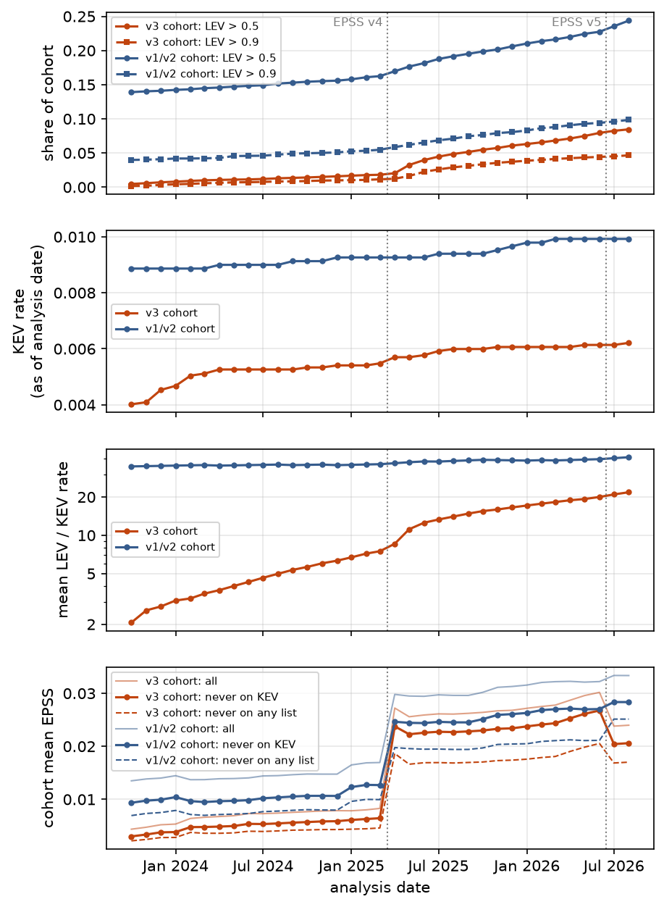

# Abstract

Vulnerability prioritization methods are routinely validated against CISA's
Known Exploited Vulnerabilities (KEV) catalogue, as if KEV listed every
exploited CVE. We measure what that assumption costs, using NIST's proposed
Likely Exploited Vulnerabilities (LEV) metric as the case study. LEV compounds
a CVE's EPSS history into a probability of past exploitation. We report what
we believe is its first empirical evaluation.

Against KEV, LEV over-predicts 17.3x. Part of that is in LEV's inputs: it
multiplies across EPSS model releases that rescale every score overnight, and
EPSS rises, rather than decays, for CVEs no list records. To separate LEV's
error from KEV's blind spots, we audit four exploitation lists for dependence,
finding that two silently contain KEV, and apply capture-recapture estimation
with pre-declared rules for when an estimate may be reported. KEV records at
most 32% of the exploited CVEs that three evidence-citing lists observe. For
LEV of 0.9 or above, the one stratum where the estimate is identified, LEV is
about 2x over-confident, not the 4.5x that KEV suggests. We release per-CVE
truth bounds so that other methods can be re-scored the same way.

# 1 Introduction

Defenders cannot patch everything, so they rank. Two public resources dominate
that ranking.

- The Exploit Prediction Scoring System (EPSS) gives each CVE a daily
  probability of exploitation in the next 30 days [2, 3].
- CISA's Known Exploited Vulnerabilities catalogue (KEV) lists CVEs with
  confirmed exploitation [4].

EPSS looks forward and KEV looks back. Neither says how likely it is that a
given CVE has *already* been exploited without anyone recording it.

Mell and Spring proposed LEV to fill that gap [1]. LEV treats each 30-day EPSS
score as the probability of exploitation in that window, and combines the
windows since the CVE first appeared:

$$\mathrm{LEV}(v, d_0, d_n) = 1 - \prod_{i}\bigl(1 - \mathrm{epss}(v, d_i)\cdot w(d_i, d_n)\bigr),$$

where $d_i = d_0 + 30i$, and $w$ is 1 for full windows and the remaining
fraction for the last one. The white paper suggests two uses: flagging high-LEV
CVEs absent from KEV as likely exploited, and measuring how complete KEV is. It
also states that assessing LEV's performance requires collaboration with
parties holding exploitation data [1]. We found no published evaluation
(Section 8).

The obvious evaluation compares LEV with KEV, but it cannot separate two
stories. If LEV says 0.99 and the CVE is not in KEV, either LEV is wrong or KEV
missed it. The second story is the one the white paper proposes LEV for. A
KEV-only evaluation therefore measures LEV's error and KEV's blindness
together, in unknown proportion. That confound is not specific to LEV: any
prioritization method validated against KEV inherits it [21-23].

We ask four questions:

- **RQ1.** Does a faithful reimplementation reproduce the white paper, and how
  calibrated is LEV against KEV?
- **RQ2.** How do LEV's inputs behave over time, and what does that do to LEV?
- **RQ3.** How much of the gap measured against KEV is KEV's incompleteness
  rather than LEV's error?
- **RQ4.** Can LEV be corrected, or used to anticipate the catalogues?

Our contributions:

1. **An evaluation of LEV and its inputs (RQ1, RQ2).** We reproduce the white
   paper's published values to within 11%. Against KEV, LEV over-predicts
   17.3x while still ranking CVEs. We trace two input effects:
   - the EPSS v4 release rescaled scores in one day, and LEV compounds across
     it;
   - EPSS rises, rather than decays, for CVEs no list records, so LEV does not
     saturate.
2. **An estimate of catalogue incompleteness (RQ3).** We audit candidate
   exploitation lists for dependence and apply capture-recapture estimation
   with pre-declared identification rules. KEV records at most a third of what
   other evidence-citing lists observe. Where the estimate is identified, LEV
   is about 2x over-confident.
3. **What can and cannot be fixed (RQ4).** A monotone correction restores
   calibration a year ahead, but drifts because LEV's meaning changes with CVE
   age. A learned aggregation of the same EPSS history does no better. LEV
   gives a strong but low-recall early signal, and most listings happen too
   soon after publication for any history-based metric to anticipate.

All data snapshots, hashes and code are released, and one command regenerates
every number in this paper (Section 11). We also release the per-CVE truth
bounds behind Section 5.6: for each of 54,612 CVEs, a lower bound and, where
identified, an estimate of the probability that it was exploited, so that any
prioritization method can be re-scored against more than KEV.

# 2 Background

## 2.1 EPSS

EPSS is a gradient-boosted model that scores every published CVE daily with
the probability of exploitation activity in the following 30 days [2, 3]. Its
ground-truth labels come from intrusion-detection and honeypot telemetry
supplied by Fortinet, AlienVault OTX, the Shadowserver Foundation and GreyNoise
[3]. The v3 model's 1,477 input features include:

- public exploit code (Exploit-DB, GitHub, Metasploit);
- offensive tool templates (Nuclei and others);
- membership of public exploitation lists, among them CISA KEV [3].

Two facts about this matter later. KEV is an *input* to EPSS, so a CVE's KEV
listing can raise its later EPSS scores. And FIRST releases new model versions:
v3 on 2023-03-07, v4 on 2025-03-17 and v5 on 2026-06-15 [44]. Each release can
move every score in the corpus at once.

## 2.2 LEV

LEV is the equation in Section 1, applied from the CVE's first EPSS date $d_0$
to an analysis date $d_n$. Each 30-day window takes the EPSS score on its
first day. The white paper also defines LEV2, which uses every daily score,
each converted to a one-day probability. Because LEV is a product over windows,
it cannot decrease as $d_n$ advances. The white paper argues the growth should
stall, because EPSS scores for old, unexploited CVEs decay toward zero [1].

## 2.3 KEV

CISA maintains KEV under Binding Operational Directive 22-01 [4]. An entry
requires reliable evidence of exploitation, an assigned CVE and clear
remediation guidance. `dateAdded` records when CISA catalogued the CVE, not
when exploitation began. KEV is selective by design: it serves federal
remediation priorities rather than aiming at complete coverage. Industry
reports already show that it lists a minority of exploited CVEs [18, 41, 42].
What has been missing is an estimate built from open data, and an account of
what that incompleteness does to evaluations that treat KEV as ground truth.

# 3 Data

**EPSS.** We use 67 monthly snapshots (the first of each month, plus the dates
Table 5 of [1] anchors on) from 2021-04-14 to 2026-08-01: 14,456,555 scores for
367,311 CVEs. A further 185 daily files serve three checks. They locate model
releases to the day, measure each release's one-day step, and bound the error
from monthly sampling (Section 9).

**CISA KEV.** catalogVersion 2026.08.25, 1,676 entries. 1,665 have EPSS data;
the other 11 were never scored and cannot receive a LEV value.

**CVE List v5.** Release `cve_2026-08-25_1700Z`, 192,054 records from 2022
onward, for CVSS, CWE and vendor.

**Exploitation lists.** The CIRCL Vulnerability-Lookup service publishes
"exploited" sightings with the source of each [5]; we retrieved all 68,191 on
2026-09-28. VulnCheck's KEV [11] lists 5,371 records, each with the URL and
date of every exploitation report behind it; we retrieved it with a community
token on the same day. We also retrieved ENISA's EU Vulnerability Database
known-exploited dump [6]. Section 4.6 describes how each became, or did not
become, a list.

**Analysis population.** Unless stated otherwise, LEV is computed at
$d_n$ = 2026-08-01. The calibration cohort is the 105,250 CVEs first scored in
the EPSS v3 era (from 2023-03-07), at least six months before $d_n$, so each
had time to reach KEV.

We exclude CVEs that EPSS backfilled. When EPSS v2 launched on 2022-02-04, its
coverage jumped from 80,800 to 168,325 CVEs, most of them old, and taking
first-EPSS date as a publication proxy would count them as new. A CVE is kept
only if EPSS first scored it within one calendar year of its CVE-ID year. 495
cohort CVEs are in KEV, a base rate of 0.47%.

**Which LEV, which population.** The paper uses two LEV variants and three
populations. Table 0 lists every LEV-versus-KEV ratio that appears later, so
the numbers can be compared.

| population | N | LEV variant | LEV / KEV rate |
|---|---|---|---|
| calibration cohort (Sections 5.1-5.2) | 105,250 | as specified [1] | 17.3x |
| calibration cohort | 105,250 | version-normalized (Section 4.3) | 12.6x |
| capture-recapture population (Section 5.4) | 54,612 | as specified | 11.2x |
| capture-recapture population | 54,612 | version-normalized | 7.9x |
| prospective test set (Section 5.5) | 44,316 | version-normalized | 6.3x |

Table 0: Every LEV-versus-KEV ratio in the paper. The capture-recapture
population is younger (first scored 2024-10-24 to 2026-01-30), so its LEV is
lower. Phase 2 analyses use version-normalized LEV; Section 5.4 also gives the
as-specified values.

**Provenance.** Every fixed input is recorded with its SHA-256 and verified on
load. KEV is vendored, and the CVE List is pinned to its release tag. EPSS
files are checked against a manifest. Sources served from moving branches or
live APIs (Exploit-DB, Metasploit, CIRCL, EUVD) are snapshotted and committed
with the code rather than re-fetched.

# 4 Methods

## 4.1 Reimplementation and reproduction

We implement LEV and LEV2 as specified, including the white paper's inclusive
day count for the final partial window and LEV2's division of each daily score
by 30. When a window starts on a date we do not hold, we take the next
available snapshot, the rule the white paper gives for its own code [1,
Sec. 10.3].

We compare the average LEV of CVEs published since each date in Table 5 of [1]
with the published values, at $d_n$ = 2025-03-01. That is close to the white
paper's own analysis date, which it does not state. LEV grows with $d_n$, so
the date matters. We therefore also report reproduction error at every monthly
$d_n$ from 2024-09-01 to 2025-09-01, with and without the backfill filter of
Section 3.

## 4.2 Calibration

We bin the cohort into ten LEV buckets and compare each bucket's mean LEV with
the fraction of its CVEs in KEV, with Wilson score intervals [7] for the
observed rates.

- We test for a monotone trend across buckets with the Cochran-Armitage test.
- We report the Brier score [9] and expected calibration error (ECE) over the
  same ten bins [10].
- We repeat the comparison by CVE age at $d_n$ (6-12, 12-24 and 24+ months),
  and for maturity rules of 3, 6 and 12 months.

## 4.3 Version normalization

EPSS releases can move every score at once, and LEV multiplies scores across
them. We estimate how much of LEV this contributes in two ways.

1. **Percentile mapping.** We map every score produced after the v4 release
   back onto the v3 scale. Each score keeps its percentile within its own day's
   file, and we substitute the score at that percentile in the last v3 file
   (2025-03-16).
2. **Step-only.** At each release (v4 on 2025-03-17, v5 on 2026-06-15) we fit
   the map once, from the last file before to the first file after, and then
   hold it fixed. This removes the one-day rescaling and leaves organic drift
   within a version untouched.

Neither method can separate a corpus-wide shift from genuine per-CVE
improvement in the newer model. The removed mass is therefore an estimate of
the artifact, not a corrected value. Phase 2 analyses use percentile-mapped
("version-normalized") LEV throughout; Section 5.4 also reports as-specified
LEV.

## 4.4 Analysis-date sweep

We take two fixed cohorts:

- 13,685 CVEs first scored March-September 2023;
- 7,558 CVEs first scored May-September 2021.

For each, we compute LEV at every month from 2023-10-01 to 2026-08-01. We
compare linear, logarithmic, two- and three-parameter saturating, quadratic,
exponential and power-law growth. Monthly residuals are strongly autocorrelated
(lag-1 correlation 0.6-0.9), so we judge the comparison with
autocorrelation-robust (HAC) standard errors and a moving-block bootstrap, not
AIC alone. The test of the white paper's premise is direct: we track mean EPSS
for cohort CVEs that no exploitation list ever records.

## 4.5 Circularity and early signal

Because KEV is an EPSS input, we test how much listing moves scores, with two
designs that cannot select on the outcome.

**The jump at listing.** For each KEV CVE we compare EPSS in the last snapshot
before `dateAdded` with the first snapshot on or after it. We net this against
non-KEV CVEs in the same starting-score decile over the same pair of snapshots,
and exclude pairs that straddle a model release.

**Pre-listing LEV.** We compute each KEV member's LEV using only snapshots
dated strictly before its listing. We compare it with non-KEV CVEs first
scored on the same date and evaluated on the same date. As a forward check, we
ask how well LEV of 0.5 or more at a fixed CVE age (three or six months)
predicts later listing.

## 4.6 Capture-recapture

**Lists.** An exploitation list is a set of CVEs that a source records as
exploited in the wild. We use four:

- CISA: CISA KEV.
- SENSOR: CIRCL sightings from Shadowserver's honeypot feed (969 CVEs), which
  records attempted exploitation directly.
- VULNCHK: VulnCheck's KEV, rebuilt from its per-report evidence (4,815 CVEs).
- SOCIAL: CIRCL sightings from Telegram and similar channels (2,396 CVEs).

**Dependence audit.** We audited every candidate for dependence before use. A
list that contains another makes their overlap equal to the smaller one by
construction. Three such cases turned up:

- CIRCL's aggregated KEV catalogue contains all 1,676 CISA KEV CVEs, so we
  exclude it.
- VulnCheck's KEV includes CISA KEV by its own documentation. We rebuild it
  from its reports and drop every report hosted on cisa.gov.
- The third was less obvious. VulnCheck's largest single source is
  Shadowserver's dashboard (401,967 reports), and every one of the 969 SENSOR
  CVEs appears in VulnCheck's Shadowserver subset. We drop those reports too.

What remains is VulnCheck's own honeypot canaries, SANS DShield, CrowdSec,
vendor advisories and threat reports. For 78% of CISA-listed CVEs, the earliest
remaining report predates CISA's listing (median 28 days), so the remainder is
not an echo of CISA.

EU KEV lists 66 CVEs, and 55 are also on CISA KEV. 36 of the 41 in our KEV
snapshot (88%) carry CISA's own date, so we treat it as derivative. ENISA's
exploited-flag search returns the same consolidated set. Exploit-DB records
exploit availability, not exploitation, and is excluded.

**Primary lists.** Telegram channels carry mass lists of CVEs that actors claim
to use, and social signals are known to be noisy [34]. We therefore take CISA,
SENSOR and VULNCHK, the three whose entries each cite evidence, as primary. We
report every other configuration alongside.

**Population.** SENSOR begins on 2024-10-24. We restrict to the 54,612 CVEs
first scored between 2024-10-24 and 2026-01-30, so every list could observe
every CVE from its first score, and apply the six-month maturity rule. 734 of
these appear on at least one primary list. We stratify by version-normalized
LEV into [0, 0.1), [0.1, 0.9) and [0.9, 1], to absorb capture heterogeneity.

**Models.** Two-list estimates among all four lists disagree by 2.4x (530 to
1,256), so the lists are not independent and dependence has to be modelled.

- We fit Poisson log-linear models to the seven observable capture patterns,
  under every hierarchical structure of two-way interactions.
- We assume no three-way interaction, the standard identifying assumption
  [12, 13].
- We select by AIC and bootstrap a 95% interval from the fitted cell means
  (1,000 replicates).
- A model whose interaction is fitted to an empty cell reaches its maximum
  likelihood only at the boundary. We score it by its extended MLE and count
  its residual degrees of freedom honestly [45]. A model left with none is
  excluded as saturated.

Chao's estimator [14] is a lower bound that stays valid under heterogeneous
capture probabilities. We use its form for $t$ lists,
$S + \frac{t-1}{t}\,f_1^2/(2f_2)$, with a log-normal interval.

**When not to report an estimate.** Log-linear estimates of the unseen cell
can be driven entirely by the choice of interaction terms, especially when
lists do not overlap [36]. We declare a population identified only if *every*
model within 2 AIC of the best:

- stays within the population;
- does not fall below the lower end of Chao's interval;
- and, for a pooled population, does not fall below the sum of the per-stratum
  Chao bounds;

and if those models agree within a factor of 2 [15]. Otherwise we report no
point estimate.

**The truth ladder.** Rather than one estimate, we report LEV's
over-confidence (mean LEV over the exploitation rate) against successively
stronger notions of truth, each adding one assumption: KEV alone; KEV or
SENSOR; the union of the primary lists; Chao's bound; the log-linear estimate.

Every rung is a lower bound on, or an estimate of, the number of CVEs
exploited, so every over-confidence figure is an upper bound on LEV's error. A
reader can stop at whichever assumption they accept.

## 4.7 Correction curve

We fit a monotone map from LEV to observed exploitation by isotonic regression
[16], by Platt scaling [17], and by a Platt variant that also takes log CVE
age. There are two targets: KEV on the calibration cohort, and the union of the
primary lists on the capture-recapture population. All scores are on held-out
CVEs, under three schemes:

- five-fold cross-validation, the in-distribution case;
- a split by first-score date, which trains on older CVEs and tests on newer
  ones;
- the deciding scheme, which is prospective. The map is fitted at
  $d_n$ = 2025-08-01 with outcomes known then, and applied at 2026-08-01 to the
  44,316 CVEs first scored after the training cohort, none of which it saw.

Prospective ratios carry bootstrap intervals over test CVEs. Appendix A tests
whether a learned aggregation of the same EPSS history beats LEV.

# 5 Results

## 5.1 RQ1: the reimplementation reproduces the white paper

| CVEs published since | CSWP 41 | ours | difference |
|---|---|---|---|
| 2023-03-07 | 0.015 | 0.0162 | +8% |
| 2022-02-04 | 0.047 | 0.0480 | +2% |
| 2021-04-14 | 0.087 | 0.0839 | -4% |
| all CVEs | 0.146 | 0.1299 | -11% |

Table 1: Average LEV at $d_n$ = 2025-03-01 against Table 5 of [1].

All four values fall within 11%. The fourth row matches only with the backfill
filter of Section 3. We added that filter after the row first missed by 75%,
but it is justified independently: first-EPSS date is a publication proxy only
for CVEs EPSS did not backfill.

The match does not depend on picking one date. With the filter, every row is
within 12% at each monthly $d_n$ from 2024-09-01 to 2025-03-01 (mean error
4-6%). Error then rises from April 2025, after the v4 release, to 70% by
September. Without the filter, no date brings the rows within 30%. This
validates the implementation. It does not validate the metric.

## 5.2 RQ1: against KEV, LEV over-predicts 17.3x but ranks

Across the 105,250-CVE cohort, mean LEV is 0.081 against a KEV rate of
0.0047: LEV over-predicts by 17.3x. The 95% interval is 15.8-18.9x, from
Poisson error on the 495 KEV CVEs; Brier 0.0373, ECE 0.0765.

The observed rate climbs from 0.03% in the lowest LEV bucket to 12.9% in the
highest, where LEV averages 0.987 (Figure 1). LEV ranks across its whole range:
even within the eight middle buckets the trend is strong (Cochran-Armitage
z = 9.2).

Over-prediction grows with CVE age (Table 1a), the first sign of an effect
that recurs in Sections 5.3 and 5.5. The six-month maturity rule is not
driving the result: with 3 or 12 months the ratio is 16.0x or 19.1x.

| CVE age at $d_n$ | N | KEV CVEs | LEV / KEV rate | KEV rate at LEV ≥ 0.9 |
|---|---|---|---|---|
| 6-12 months | 22,043 | 82 | 6.6x [5.3, 8.3] | 27.1% |
| 12-24 months | 40,875 | 200 | 15.1x [13.1, 17.4] | 16.3% |
| 24+ months | 42,332 | 213 | 23.4x [20.5, 26.9] | 9.8% |

Table 1a: Calibration against KEV by CVE age.

## 5.3 RQ2: EPSS releases put an artifact into LEV

EPSS v4 went live on 2025-03-17 [44]. Its version string, v2025.03.14, is a
build date, so bracketing by version string places the change two weeks early
and measures almost no step.

On an unchanged set of 13,552 cohort CVEs, mean EPSS goes from 0.00862 on
2025-03-16 to 0.02640 the next day, a 3.06x step (Figure 2). The whole corpus
moves only 1.21x, and the cohort's rank correlation across the step is 0.61.
For young CVEs, v4 re-ranked as much as it rescaled. Of the rise in cohort EPSS
over 2023-2026, 64% (v3 cohort) and 70% (v1/v2 cohort) happens at release
boundaries rather than between them.

EPSS v5 (2026-06-15) moved the same cohort the other way: its mean fell to
0.79x of the previous day's.

LEV multiplies scores across these boundaries as if they belonged to one
measurement series. Removing the one-day rescaling at the v4 and v5 boundaries
lowers mean LEV by 27-29%:

- 26.9% by percentile mapping;
- 29.0% step-only.

Over-prediction against KEV falls from 17.3x to 12.3-12.6x (normalized: Brier
0.0289, ECE 0.0547). Treating *all* of the cohort's re-ranking at v4 as
artifact gives an upper bound of 62%.

Version mixing therefore explains between a quarter and three-fifths of LEV's
mass. Even the upper bound leaves LEV over-predicting KEV by 6.6x.

## 5.4 RQ2: LEV grows without saturating, because EPSS does not decay

For the 2023 cohort, mean LEV rises from 0.008 to 0.135 between October 2023
and August 2026 (Figure 3). Monotone growth is a property of the equation, not
a finding. The empirical questions are whether it slows, and whether the
premise behind an expected slowdown holds.

It does not slow. A three-parameter saturating model collapses to its linear
limit. Within the retraining-free stretch, the curvature term is significant
under autocorrelation-robust errors (HAC z = 3.33). A moving-block bootstrap
rejects linear (p = 0.034) and saturating (p = 0.018) growth in favour of
accelerating growth. The data cannot separate a quadratic from a power law.

The premise fails directly. For the 13,390 cohort CVEs that no exploitation
list records, mean EPSS rises from 0.0022 to 0.0046 within the single v3 model
(p = 3 x 10^-8), and reaches 0.0170 by August 2026 across releases. Scores for
old, unlisted CVEs rise; they do not decay. With no decay, LEV keeps
compounding and, over time, more of the corpus approaches 1.

## 5.5 RQ4: LEV's early signal is strong but rare, and its top bucket is partly circular

**The listing feedback.** At the listing date, the median KEV CVE's EPSS does
not move relative to matched non-KEV controls. But a quarter of listed CVEs
rise at least 2.85x more than their controls. The KEV input feature matters for
a sizeable minority of listings rather than all of them.

**Before listing.** 56% of cohort KEV members were listed in the same month
EPSS first scored them, so no history-based metric could have flagged them
first. 220 have a pre-listing history (median 2.8 months).

- **Before listing, LEV was 25 times more likely to be high.** Using only
  snapshots dated strictly before listing, 15% of the 220 had LEV of 0.5 or
  more, against 0.58% of non-KEV CVEs first scored on the same date and
  evaluated on the same date.
- **The typical member already stood out.** Its pre-listing LEV (median 0.005)
  sat at the 92nd percentile of its matched controls.
- **After listing, the median is 1.0.** Over the same period, same-age controls
  move only from 0.0013 to 0.017, so elapsed time explains little of that jump.

**As a forecaster.** At a fixed CVE age of three months, LEV of 0.5 or more
picks out CVEs listed later with 6.0% precision (59 times the base rate), but
with 10% recall.

So LEV carries a real early signal, but for few CVEs. Most of the top bucket's
KEV concentration (Section 5.2) arrives after listing, and is partly circular.

## 5.6 RQ3: how much of the gap is the catalogue's

Table 2 gives the truth ladder on the 54,612-CVE capture-recapture population
with the three primary lists.

| truth | assumption added | exploited | over-confidence | as-specified LEV |
|---|---|---|---|---|
| CISA KEV | KEV is complete | 236 | 7.93x [6.98, 9.05] | 11.16x |
| CISA or SENSOR | honeypot sightings are real | 336 | 5.57x [5.01, 6.22] | 7.84x |
| union of primary lists | every listed report is real | 734 | 2.55x [2.37, 2.75] | 3.59x |
| Chao lower bound | closed population | 974 | 1.92x [1.79, 2.04] | 2.70x |
| log-linear | no three-way interaction | not identified | | |

Table 2: LEV over-confidence against successively stronger notions of truth,
all LEV strata pooled, version-normalized LEV, with as-specified LEV alongside.
Intervals are 95%: Poisson on the counts, log-normal for Chao.

By counting alone, over-prediction falls from 7.9x to 2.6x. 68% [64, 71] of the
CVEs that any primary list records are absent from KEV: 60% [55, 64] if
VulnCheck entries resting on a single report are dropped. KEV recorded at most
32% of the exploited CVEs the primary lists observed, and at most 24% under
Chao's bound.

The pooled log-linear estimate falls below Chao's bound and is not reported.
Table 3 stratifies by LEV.

| LEV | N | mean LEV | vs KEV | union | Chao | log-linear |
|---|---|---|---|---|---|---|
| [0.0, 0.1) | 52,012 | 0.012 | 21.2x | 2.36x | 1.05x [0.83, 1.29] | not identified |
| [0.1, 0.9) | 1,964 | 0.322 | 9.16x | 3.21x | 2.54x [2.24, 2.76] | not identified |
| [0.9, 1.0] | 636 | 0.985 | 4.54x | 2.26x | 2.05x [1.93, 2.14] | **2.04x [1.81, 2.32]** |

Table 3: Over-confidence by LEV stratum, primary lists, version-normalized LEV.

**The top stratum is identified.** LEV averages 0.985, and we estimate that
48% [42%, 54%] of those CVEs were exploited: about 2x over-confident, against
the 4.5x that KEV alone suggests. As-specified LEV gives the same figure there
(2.04x).

**The middle stratum is not identified.** No CVE in it is on both CISA and
SENSOR. The two best models fit that empty cell at the boundary and have no
residual degrees of freedom, and the model that remains falls below Chao's
bound. Chao's bound alone caps over-confidence there at 2.5x (3.2x by counting).

**The lowest stratum is not identified either,** and it holds 95% of the CVEs.
Chao's bound alone brings it to 1.05x [0.83, 1.29]. There, LEV may not
over-predict at all.

**Does this hinge on the choice of lists?** Table 4 repeats the estimate under
every configuration.

| lists | LEV [0.9, 1.0] | LEV [0.1, 0.9) | all LEV |
|---|---|---|---|
| CISA, SENSOR, VULNCHK (primary) | 2.04x [1.81, 2.32] | not identified | not identified |
| CISA, SENSOR, strict VULNCHK | 2.12x [1.85, 2.43] | not identified | 2.64x [2.34, 2.93] |
| CISA, SENSOR, SOCIAL | 2.07x [1.76, 2.45] | not identified | not claimed (0.99x) |
| CISA, SOCIAL, VULNCHK (no SENSOR) | 1.92x [1.66, 2.23] | 1.22x [0.69, 1.70] | not identified |
| all four | not identified | not identified | not claimed (0.35x) |

Table 4: Log-linear over-confidence by list configuration. "Not claimed":
passes the rules pooled, but pooled over strata that the stratified analysis
rejects.

Wherever the top stratum is identified, its estimate lies between 1.92x and
2.12x. That includes the strict configuration, which keeps a VulnCheck CVE only
if a sensor saw it or at least two independent sources reported it (2,912
CVEs). That check matters: VulnCheck supplies most CVEs seen by a single list,
and 65% of VulnCheck-only CVEs rest on one text report.

Three further checks:

- **No SENSOR.** Shadowserver is one of EPSS's label sources, so EPSS is
  trained to predict roughly what SENSOR records. Counting with CISA and
  VULNCHK alone gives 2.65x pooled and 2.38x at the top.
- **S×V dependence.** Removing Shadowserver-sourced reports from VulnCheck may
  create negative dependence between SENSOR and VULNCHK by construction.
  Forcing that interaction into every model leaves nothing identified; at the
  top it gives 2.24x.
- **The listing boost.** The boost of Section 5.5 lifts some KEV members into
  the top stratum. They are true positives, so removing the boost would, if
  anything, raise the top stratum's 2x.

## 5.7 RQ4: a correction curve, and why it drifts

| method | Brier | ECE | predicted / observed |
|---|---|---|---|
| LEV (version-normalized) | 0.0113 | 0.0230 | 6.30x [5.56, 7.27] |
| LEV (as specified) | 0.0136 | 0.0339 | 8.81x [7.77, 10.18] |
| isotonic | 0.0036 | 0.0020 | 0.61x [0.53, 0.70] |
| Platt | 0.0037 | 0.0015 | 0.66x [0.58, 0.76] |
| Platt with CVE age | 0.0036 | 0.0014 | 0.72x [0.63, 0.83] |

Table 5: Prospective validation against KEV. Fitted at 2025-08-01; scored at
2026-08-01 on 44,316 CVEs the fit never saw.

Under cross-validation, any of the three maps restores calibration (predicted
over observed 1.00-1.01x). Prospectively against KEV, each map cuts
calibration error 11-17x, but all under-predict by 28-39% a year later.

Against the union of the primary lists, the maps fitted on 111 training
positives and scored on 597 test positives give:

- isotonic: 1.00x [0.93, 1.08];
- Platt: 0.80x [0.74, 0.87];
- age-aware Platt: 0.88x [0.81, 0.95].

Much of the KEV-target drift therefore reflects KEV's narrow and lagging
coverage rather than the correction itself.

Transfer across birth cohorts is worse. A map fitted on CVEs first scored
before 2025-06-01 under-predicts the younger ones at the same analysis date
(isotonic 0.30x, Platt 0.52x against the union), and the age-aware Platt model
overshoots (2.32x).

The drift has a cause we can name. An old CVE reaches a given LEV through many
windows of modest EPSS, and a new one through a few high scores. The second is
stronger evidence, so the same LEV value carries a different probability at
different ages. That is Table 1a seen from another side. A Platt model that
also takes log age recovers about a quarter of the drift.

**A learned aggregation does no better (Appendix A).** We also gave a logistic
regression and a gradient-boosted model the same EPSS history LEV sees, and
nothing else. Neither ranks exploited CVEs better than LEV or current EPSS a
year ahead, on any target. In a forward test across three origins, no method
anticipates new list entries better than current EPSS. 59-75% of each window's
listings concern CVEs first scored less than 30 days earlier, which no
history-based metric can see in advance.

An apparent learned gain appears only with un-normalized inputs and KEV-listed
CVEs in the target, and vanishes when either is removed.

| LEV | corrected to KEV | corrected to union of primary lists |
|---|---|---|
| 0.10 | 0.8% [0.5, 1.0] | 6.1% [4.6, 7.5] |
| 0.50 | 2.7% [1.9, 4.1] | 15.5% [11.5, 19.0] |
| 0.90 | 6.7% [4.4, 8.4] | 20.2% [16.5, 29.5] |
| 0.99 | 8.2% [6.4, 10.1] | 32.5% [26.9, 37.4] |
| 1.00 | 27.8% [24.3, 30.9] | 76.3% [68.0, 85.9] |

Table 6: The isotonic correction, fitted on all data, with 95% bootstrap
intervals (400 resamples of CVEs). Both targets are catalogue appearance, so
both are lower bounds on true exploitation. The intervals are several points
wide: the curve gives the scale of LEV's error, not a precise mapping for a
single score.

# 6 Discussion

**What LEV is good for.** LEV ranks. Its extremes separate (the top bucket's
KEV rate is nearly 500 times the bottom bucket's), and the trend holds across
the middle of its range. Its values should not be read as probabilities. A LEV
of 0.9 corresponds to about 7% chance of KEV listing, and about 20% chance of
appearing on any primary list.

**What LEV is not good for yet.** The white paper proposes LEV for finding
exploited CVEs that KEV misses. Our results cut both ways.

- LEV's apparent over-confidence is substantially KEV's incompleteness, which
  is the premise of the proposal.
- Before listing, a high LEV is 25 times more common among CVEs that KEV later
  lists.
- But it flags only 15% of them, and most listings happen within a month of a
  CVE's first EPSS score, before any history accumulates.

LEV can support the proposal at the margin. It cannot carry it.

**What would make LEV more reliable.** Five changes follow from the results.

1. Compute LEV within one EPSS model version, or normalize across releases,
   since a release otherwise enters as evidence.
2. State the analysis date with every published LEV value, since values are
   not comparable across dates.
3. Stop accumulating, or decay, windows for CVEs with no recent evidence, or
   accept that LEV drifts toward 1.
4. Read LEV through a correction that is refitted as CVEs age, not at face
   value.
5. Validate against more than KEV: KEV is both an EPSS input and incomplete.

**KEV coverage, and evaluations built on it.** Empirical Security reports that
KEV covers at most about 8.7% of CVEs with observed exploitation activity, from
proprietary telemetry [18]. Our figures come from open data on a younger
population: KEV recorded at most 32% of what the primary lists observed, and at
most 24% under Chao's bound.

The direction agrees. The levels differ as they should, since three lists see
less than one vendor's full telemetry. Any method tuned or tested on KEV
[21-23] measures, in part, CISA's visibility. The learned-model reversal in
Appendix A shows how such an evaluation can report gains that are pure feedback.

**Two definitions of "exploited."** Part of the KEV gap is definitional. EPSS
is trained on intrusion-detection and honeypot detections, so LEV estimates
the probability of observed exploitation *activity*. KEV lists confirmed,
actionable exploitation. Against sources closer to EPSS's own definition, LEV
in its top stratum looks about twice too confident rather than four or five
times.

**Implications for policy and practice.** KEV's selectivity is deliberate.
Under BOD 22-01 every entry is a remediation deadline for federal agencies, so
it must be confirmed and actionable [4]. The problem is not KEV but its second
life as ground truth.

- *Evaluations and vendor claims.* "Catches X% of KEV" measures agreement with
  CISA's visibility, which here covers at most a third of observed
  exploitation. A method that finds exploited CVEs KEV has missed, the use the
  white paper proposes for LEV, is penalised for it.
- *The cost of acting on LEV.* Read as triage, the strata translate into work
  per exploited CVE found. Against KEV, a defender working through LEV ≥ 0.9
  examines about 4.6 CVEs per hit; against the estimated truth, about 2.1. In
  the middle stratum it is at most about 8 (Chao), and in the lowest at most
  about 89. KEV-based figures more than double the apparent cost of working
  the top of the list.
- *Stable inputs.* A metric that compounds EPSS history is only as stable as
  that history. Publishing cross-version mappings or back-scored history at
  each EPSS release, and stating the analysis date and model version with every
  published LEV value, would remove the artifact of Section 5.3 at its source.
- *Auditable provenance.* The dependence audit was possible only because
  VulnCheck publishes the source of every report behind each entry. Catalogues
  that publish per-entry provenance can be combined; catalogues that do not
  can only be compared.

# 7 Threats to validity

We record 55 threats in the released repository (`docs/THREATS.md`). The ones
that bear most on the conclusions:

- **Version-normalized LEV.** Phase 2 uses version-normalized LEV. As-specified
  LEV gives higher over-confidence everywhere except the top stratum, where the
  two agree (Table 2, Section 5.6).
- **Lists sample different things.** KEV only lists CVEs with remediation
  guidance and federal relevance. Honeypots see only internet-reachable
  exploitation. These structural zeros violate the shared-population
  assumption, and stratifying by LEV does not repair them; they bias
  capture-recapture estimates downward.
- **Catchability changes with age.** In CIRCL's comparison, Shadowserver's
  catalogue lists CVEs at a median age of 532 days, against 252 for CISA [40]. Our population is
  observed for only 6-21 months, so late listings are still to come.
- **Strata depend on capture.** KEV listing raises later EPSS (Section 5.5), so
  capture moves CVEs into the top stratum. Stratifying on pre-listing LEV
  would avoid this.
- **Monthly sampling.** LEV's windows are 30 days and our snapshots are about
  30.4 days apart. On 481 CVEs stratified by LEV decile, LEV from true daily
  windows differs from ours by 3.9% of mean LEV (population-weighted), with no
  consistent sign.
- **Publication-date proxy.** We use first EPSS appearance as publication date,
  with a backfill filter added after a first miss (Section 5.1).
- **Circularity.** KEV is an EPSS input, and Shadowserver is an EPSS label
  source. We measure the first and drop the second as a check; we cannot
  remove either from EPSS.
- **List dependence and sparse cells.** The log-linear model assumes no
  three-way interaction. We report estimates only where identified, and Table
  4 shows how each configuration changes them.
- **VulnCheck precision and dates.** 65% of VulnCheck-only CVEs rest on one
  text report; the strict configuration keeps the top-stratum result.
  VulnCheck dates come from a later snapshot and may be backdated, which
  affects the forward test of Appendix A. That test is also run on CISA and
  SENSOR dates alone.
- **Nested sources.** Two catalogues contain CISA KEV, and VulnCheck contains
  Shadowserver's list. Each was removed by source before modelling. A
  containment we did not detect would bias the estimates downward.
- **False sightings.** Telegram sightings include claims we cannot verify.
  Every headline figure is also given with that list excluded.
- **A short, young population.** SENSOR starts in October 2024, so the
  capture-recapture population covers CVEs first scored over 15 months.
- **Normalization.** Neither normalization separates corpus-wide shift from
  genuine improvement in the newer model, so the artifact is reported as a
  range.
- **KEV dates.** `dateAdded` is a cataloguing date, so timing comparisons are
  lagged by an unknown amount.
- **Search scope.** On 2026-10-28 we queried the arXiv API for every paper
  since May 2025 matching "likely exploited", EPSS, "known exploited
  vulnerabilities", "exploited in the wild", or capture-recapture with
  vulnerabilities, screened the abstracts, read every paper that cites the
  white paper, checked the WEIS 2026 programme, and ran web searches. This is
  a structured search, not a formal systematic review, and peer-reviewed work
  not on arXiv may be missed.

# 8 Related work

**Exploit prediction.** Learning which vulnerabilities get exploited predates
EPSS:

- case-control comparisons of severity scores against exploitation [33];
- social-media signals [34];
- exploit-development forecasting [30];
- exploit prediction for remediation policy [32].

Field measurements found that only a minority of disclosed vulnerabilities are
ever exploited in the wild: no product studied had more than 35% [47]. EPSS was introduced by Jacobs et
al. [2] and extended in version 3 [3]. Parla evaluates EPSS on high-severity
CVEs in KEV [19]. Koscinski et al. document how often vulnerability scores
disagree [35]. Nucleus Security reports that EPSS moves far more after KEV
listing than before [43], consistent with Section 5.5. Mell et al. note that
EPSS's training labels come mainly from network intrusion-detection sensors,
which can miss exploitation that only other mechanisms see [52]. None of these
evaluates LEV.

**LEV.** Beyond the white paper [1], an independent reimplementation by the
Risk Based Prioritization project questions LEV's small-probability
approximation and its independence assumption [20]. It does not validate LEV
against exploitation data. LEV is already consumed downstream: Huang et al. use
it, alongside EPSS and KEV, as an exposure probability for incident mitigation
in cyber-physical systems [26], and newer prioritization work cites it as an
EPSS complement without testing it [48]. We found no empirical evaluation of
LEV.

**KEV as ground truth.** Recent frameworks combine CVSS, EPSS and KEV [21, 50],
build composite risk indicators evaluated on KEV [22], train a ranking model
with KEV entries as weak supervision [23], or order dependency upgrades by KEV
membership [49]. Prospective evaluations increasingly guard against temporal
leakage in the evidence [51], but the label itself is still taken as complete.
The GitHub Popularity Metric is evaluated against CISA KEV and against a pooled
set that also includes VulnCheck's KEV [48]; our audit shows that the latter
contains the former by construction, so the pooled set is not an independent
second check. Shaffer and Voicu model exploitation hazard with a decay
calibrated on KEV timing [24]; our cohorts show EPSS rising, not decaying.

Industry analyses already show that KEV is incomplete and lagging [18, 41, 42],
and CIRCL has compared five KEV-style catalogues descriptively [40]. We add a
population estimate, the dependence audit those comparisons need, and its
consequence for one metric.

**Learning from incomplete labels.** Exploitation lists give positives and
unlabelled CVEs, the setting of positive-unlabeled learning [27, 31]. Under its
selected-completely-at-random assumption, ranking evaluations survive
incompleteness. Our vendor audit shows that assumption fails for KEV. We
follow the temporal-split and label-quality guidance of the security-ML
pitfalls literature [28, 29].

**Multiple-systems estimation.** Capture-recapture over administrative lists is
standard in epidemiology [12] and in public policy [46]. It has been used to
estimate casualties and modern slavery, where its sensitivity to list
dependence and sparse, non-overlapping cells is well documented [25, 36]. In
software engineering it estimates defects missed by inspections [39]. Closest
to our setting, Meurs et al. link police reports, incident-response cases and
leak sites to estimate the number of ransomware attacks on Dutch businesses
[8]. Overlap between independent discoveries has been used to estimate
vulnerability rediscovery rates [37, 38]. We found no prior application to
vulnerability exploitation.

# 9 Conclusion

Evaluated against KEV, LEV looks badly over-confident. Much of that is not
LEV's doing.

- EPSS releases put an artifact into the product LEV computes.
- EPSS does not decay for unlisted CVEs, so LEV accumulates without the
  saturation its design assumes.
- KEV records a minority of the exploitation that other evidence-citing
  sources observe.

Once that is accounted for, LEV's most confident scores over-predict estimated
true exploitation by about 2x, rather than the 4.5x that KEV suggests. Below
that, the data bound the error but do not identify it: at most 2.5x in the
middle stratum, and possibly none in the lowest.

A monotone correction brings LEV's values in line with the broader ground
truth a year ahead, though it must be refitted as CVEs age. Neither LEV nor a
learned aggregation of EPSS history can anticipate most listings.

The lowest LEV stratum holds most CVEs, and four lists cannot identify it. A
fifth independent list with sensor coverage, such as GreyNoise's or
Shadowserver's own KEV catalogue [40], is the natural next step. The method is
not specific to LEV: any metric validated against KEV can be re-scored against
the same truth ladder.

# 10 Ethics and data

All inputs are public or available under a free community licence. No
personal data is processed.

- CISA KEV is a US-government work and is vendored with the code.
- EPSS scores, the CVE List and CIRCL sightings are used under their
  providers' terms.
- VulnCheck's terms do not say whether its data may be redistributed, so its
  snapshot is not released. Reproducing the four-list results needs a free
  community token, and all other results reproduce without it.
- Telegram-derived sightings are used only as aggregated counts per CVE, as
  CIRCL publishes them.
- The released per-CVE truth bounds name no person or organisation; they hold
  CVE identifiers, LEV values, list membership and probabilities.

# 11 Data and code availability

The code, pinned data and per-CVE truth bounds are archived at [DOI on
release]. `make fetch` downloads the pinned inputs, `make verify-data` checks
them against recorded hashes, and `make reproduce` regenerates every table and
figure offline. SHA-256 hashes, release tags and retrieval dates for all inputs
are listed in `DATA_SNAPSHOT.md`.

The truth bounds (`results/truth_bounds*.csv`, `analysis/truth_bounds.py`) give
one row per CVE in the capture-recapture population: LEV as specified and
version-normalized, membership of each list, and the probability of
exploitation under counting, under Chao's bound, and under the log-linear
estimate where identified. A variant built from CISA, SENSOR and SOCIAL alone
contains no VulnCheck-derived data; the primary-list version will be released
if VulnCheck's terms permit.

# Appendix A: a learned aggregation of EPSS history

**Question.** LEV combines a CVE's EPSS history with one fixed rule. Would a
model that sees the same history, and nothing else, combine it better? We
restrict the inputs so that the comparison tests LEV's rule, not the value of
extra data.

**Design.** Seven features, all computed from version-normalized EPSS dated on
or before the analysis date: LEV, log CVE age, and current, peak, mean, first
and three-month-trend EPSS. There are two learners:

- L2 logistic regression, with probability features on the logit scale;
- gradient-boosted trees, monotone in LEV and heavily regularized.

The choice between them is fixed by a rule that sees only training data: fit
on the older two-thirds of the training cohort, validate on the newer third,
keep the higher average precision (AP). We wrote this rule after a first,
unreported run, and we report both models throughout. Baselines are LEV,
current EPSS, peak EPSS, and the maps of Section 4.7.

*Experiment 1* repeats the prospective test of Section 4.7 with three targets:

- the union of primary lists;
- CISA KEV;
- the union with every KEV-listed CVE removed from training and test, which
  cuts the path by which a listing raises later scores.

The logistic model's bootstrap resamples training *and* test CVEs and refits,
so its intervals include training variance.

*Experiment 2* is forward. At origin $t$ we take every CVE that is at least 30
days old and on no list. We compute features at $t$ and label the CVE positive
if it is first listed in the next 182 days. Training uses the origin one
horizon earlier. There are three test origins (2025-08-02, 2025-10-31,
2026-01-30), and a second target that uses only CISA and SENSOR dates.

| method | union AP (pred/obs) | KEV AP (pred/obs) | union without KEV AP (pred/obs) |
|---|---|---|---|
| LEV | 0.399 (2.03x) | 0.324 (6.30x) | 0.228 (2.66x) |
| current EPSS | 0.404 (0.65x) | 0.457 (2.02x) | 0.221 (0.72x) |
| peak EPSS | 0.424 (0.97x) | 0.459 (3.03x) | 0.237 (1.17x) |
| isotonic | 0.337 (1.00x) | 0.239 (1.29x) | 0.203 (0.94x) |
| Platt with age | 0.366 (0.88x) | 0.329 (0.61x) | 0.180 (1.20x) |
| logistic | 0.398 (0.99x) | 0.196 (1.52x) | 0.190 (0.74x) |
| boosted trees | 0.309 (1.05x) | 0.127 (2.47x) | 0.089 (0.45x) |

Table A1: Experiment 1. Fitted 2025-08-01, scored 2026-08-01 on 44,316 unseen
CVEs (597, 192 and 405 positives; 111, 41 and 70 in training).

**No learned aggregation ranks better.** On every target, the logistic
model's AP is within noise of LEV's:

- union: difference -0.134 to +0.035;
- union without KEV: -0.137 to +0.021;
- CISA KEV: -0.229 to +0.001, and significantly below current EPSS (-0.354 to
  -0.124).

The boosted model is significantly worse than LEV on all three targets. The
rule picked logistic in five of six splits. Peak EPSS alone is as good as
anything.

**An apparent gain was an artifact.** A first version of this experiment used
un-normalized EPSS and kept KEV-listed CVEs in the target. There, the logistic
model beat LEV (AP 0.435 against 0.397). The gain disappears when either
condition is removed:

- with version-normalized inputs, AP is 0.398 against 0.399;
- with KEV members dropped, the difference is -0.051 to +0.006 against LEV,
  and -0.029 to -0.004 against current EPSS.

A model trained on lists that feed EPSS learns the feedback.

| test origin | positives / N | base rate | LEV | current EPSS | logistic | boosted trees |
|---|---|---|---|---|---|---|
| 2025-08-02 | 71 / 32,223 | 0.22% | 0.035 | 0.042 | 0.019 | 0.007 |
| 2025-10-31 | 105 / 43,059 | 0.24% | 0.029 | 0.027 | 0.038 | 0.026 |
| 2026-01-30 | 97 / 49,678 | 0.20% | 0.020 | 0.025 | 0.022 | 0.010 |

Table A2: Experiment 2, union target. AP for first listing in the next 182
days, among unlisted CVEs at least 30 days old.

**Nothing anticipates the lists.** Across three forward origins, no method's
AP is significantly above current EPSS. The boosted model is significantly
below it at two origins, and the logistic model at one. Current EPSS is never
significantly worse than LEV, and is slightly better at two of the three
origins with CISA and SENSOR dates.

59-75% of the listings in each window concern CVEs first scored less than 30
days before the window, so no history-based method can see them in advance.

**Threats.**

- Training sets are small (24-111 positives).
- Experiment 1 has one split.
- There are many intervals and no multiplicity correction, so these results
  are exploratory.
- SENSOR is an EPSS label source, so some circularity remains even without
  KEV.

# Appendix B: further robustness

- **Reproduction against analysis date** (Section 5.1):
  `results/validate_dn_grid.json`.
- **Calibration by age and maturity rule** (Table 1a): `results/calibration.json`.
- **Growth families, HAC and block-bootstrap comparisons, and EPSS for
  never-listed CVEs** (Section 5.4): `results/dn_sweep.json`, Figure B1.
- **Version artifact under percentile, step-only and cohort-fit maps, and the
  v4 and v5 one-day steps** (Section 5.3): `results/version_normalize.json`.
- **Matched-control early-signal analysis** (Section 5.5): `results/leakage.json`.

# References

See `references.md` for full entries and verification status.

[1] P. Mell and J. Spring. Likely Exploited Vulnerabilities: A Proposed Metric for Vulnerability Exploitation Probability. NIST CSWP 41, May 2025.
[2] J. Jacobs, S. Romanosky, B. Edwards, I. Adjerid, M. Roytman. Exploit Prediction Scoring System (EPSS). Digital Threats: Research and Practice 2(3), 2021.
[3] J. Jacobs, S. Romanosky, O. Suciu, B. Edwards, A. Sarabi. Enhancing Vulnerability Prioritization: Data-Driven Exploit Predictions with Community-Driven Insights. arXiv:2302.14172, 2023.
[4] CISA. Known Exploited Vulnerabilities Catalog; BOD 22-01.
[5] CIRCL. Vulnerability-Lookup, sightings API.
[6] ENISA. EU Vulnerability Database API.
[7] E. B. Wilson. Probable inference, the law of succession, and statistical inference. JASA 22(158), 1927.
[8] T. Meurs, M. Junger, M. Cruyff, P. G. M. van der Heijden. Estimating the Number of Ransomware Attacks. Journal of Quantitative Criminology 42(2):227-243, 2026 (online July 2025). doi:10.1007/s10940-025-09625-7
[9] G. W. Brier. Verification of forecasts expressed in terms of probability. Monthly Weather Review 78(1), 1950.
[10] M. P. Naeini, G. Cooper, M. Hauskrecht. Obtaining well calibrated probabilities using Bayesian binning. AAAI 2015.
[11] VulnCheck. VulnCheck KEV documentation.
[12] International Working Group for Disease Monitoring and Forecasting. Capture-recapture and multiple-record systems estimation I. Am. J. Epidemiology 142(10), 1995.
[13] Y. M. M. Bishop, S. E. Fienberg, P. W. Holland. Discrete Multivariate Analysis. MIT Press, 1975.
[14] A. Chao. Estimating the population size for capture-recapture data with unequal catchability. Biometrics 43(4), 1987.
[15] K. P. Burnham and D. R. Anderson. Model Selection and Multimodel Inference, 2nd ed. Springer, 2002.
[16] B. Zadrozny and C. Elkan. Transforming classifier scores into accurate multiclass probability estimates. KDD 2002.
[17] J. Platt. Probabilistic outputs for support vector machines and comparisons to regularized likelihood methods. Advances in Large Margin Classifiers, 1999.
[18] M. Roytman. The KEV Paradox. Empirical Security, 2026.
[19] R. Parla. Efficacy of EPSS in High Severity CVEs found in KEV. arXiv:2411.02618, 2024.
[20] Risk Based Prioritization project. NIST LEV. riskbasedprioritization.github.io/epss/LEV.
[21] N. Shimizu and M. Hashimoto. Vulnerability Management Chaining. arXiv:2506.01220, 2025.
[22] E. Sherif, I. Yevseyeva, V. Basto-Fernandes, A. Cook. Bridging the Gap Between Security Metrics and Key Risk Indicators. arXiv:2603.12450, 2026.
[23] S. Motamedi Sedeh et al. ThreatLens: Evidence-Guided Ranking of High-Priority CVEs. arXiv:2608.22306, 2026.
[24] S. Shaffer and L. Voicu. Modeling Local Exploit Hazard. arXiv:2607.24618, 2026.
[25] O. Binette and R. C. Steorts. On the Reliability of Multiple Systems Estimation for the Quantification of Modern Slavery. J. Royal Statistical Society Series A, 2022. arXiv:2112.01594.
[26] S. Huang, C. M. Poskitt, L. K. Shar. Bayesian and Multi-Objective Decision Support for Incident Mitigation in Cyber-Physical Systems. arXiv:2509.00770, 2025.
[27] C. Elkan and K. Noto. Learning Classifiers from Only Positive and Unlabeled Data. KDD 2008.
[28] D. Arp, E. Quiring, F. Pendlebury, A. Warnecke, F. Pierazzi, C. Wressnegger, L. Cavallaro, K. Rieck. Dos and Don'ts of Machine Learning in Computer Security. USENIX Security 2022.
[29] F. Pendlebury, F. Pierazzi, R. Jordaney, J. Kinder, L. Cavallaro. TESSERACT: Eliminating Experimental Bias in Malware Classification across Space and Time. USENIX Security 2019.
[30] O. Suciu, C. Nelson, Z. Lyu, T. Bao, T. Dumitras. Expected Exploitability: Predicting the Development of Functional Vulnerability Exploits. USENIX Security 2022.
[31] J. Bekker and J. Davis. Learning from Positive and Unlabeled Data: A Survey. Machine Learning 109(4), 2020.
[32] J. Jacobs, S. Romanosky, I. Adjerid, W. Baker. Improving Vulnerability Remediation through Better Exploit Prediction. Journal of Cybersecurity 6(1), 2020.
[33] L. Allodi and F. Massacci. Comparing Vulnerability Severity and Exploits Using Case-Control Studies. ACM TISSEC 17(1), 2014.
[34] C. Sabottke, O. Suciu, T. Dumitras. Vulnerability Disclosure in the Age of Social Media: Exploiting Twitter for Predicting Real-World Exploits. USENIX Security 2015.
[35] V. Koscinski, M. Nelson, A. Okutan, R. Falso, M. Mirakhorli. Conflicting Scores, Confusing Signals: An Empirical Study of Vulnerability Scoring Systems. ACM CCS 2025, pp. 1904-1918.
[36] L. Chan, B. W. Silverman, K. Vincent. Multiple Systems Estimation for Sparse Capture Data: Inferential Challenges When There Are Nonoverlapping Lists. JASA, 2020.
[37] T. Herr, B. Schneier, C. Morris. Taking Stock: Estimating Vulnerability Rediscovery. Belfer Center, 2017.
[38] L. Ablon and A. Bogart. Zero Days, Thousands of Nights. RAND RR-1751, 2017.
[39] H. Petersson, T. Thelin, P. Runeson, C. Wohlin. Capture-Recapture in Software Inspections after 10 Years Research. Journal of Systems and Software 72(2), 2004.
[40] CIRCL. What Do KEV Catalogs Actually Know? 13 September 2026.
[41] P. Garrity. State of Exploitation 2026. VulnCheck, January 2026.
[42] T. Beardsley. KEVology. runZero.
[43] T. Netzer. EPSS Score Is Predictive, but Late. Nucleus Security, May 2026.
[44] FIRST. EPSS (first.org/epss), release notice for v4, 17 March 2025; J. Jacobs, Introducing EPSS Version 4, Empirical Security, 17 March 2025; Empirical Security, EPSS V5 Is Here, June 2026.
[45] S. E. Fienberg and A. Rinaldo. Maximum Likelihood Estimation in Log-Linear Models. Annals of Statistics 40(2):996-1023, 2012.
[46] S. M. Bird and R. King. Multiple Systems Estimation (or Capture-Recapture Estimation) to Inform Public Policy. Annual Review of Statistics and Its Application 5:95-118, 2018.
[47] K. Nayak, D. Marino, P. Efstathopoulos, T. Dumitraş. Some Vulnerabilities Are Different Than Others: Studying Vulnerabilities and Attack Surfaces in the Wild. RAID 2014, LNCS 8688, pp. 426-446.
[48] J. Akhoundali, K. Rietveld, O. Gadyatskaya. GitHub Engagement Signals for CVE Prioritization: The GitHub Popularity Metric (GPM). arXiv:2609.31004, 2026.
[49] D. O. Omondi. KEVGraph: Exploitation-Aware Dependency Vulnerability Remediation. arXiv:2609.24164, 2026.
[50] R. Podder, V. Koscinski, I. Ray. CAPE: Context-Aware Prioritization Engine for Vulnerability Scoring and Management. arXiv:2610.13071, 2026.
[51] F. Alpay and T. Alpay. Compute-Budgeted Exploitability Evidence Graphs for Prospective Vulnerability Triage. arXiv:2606.19076, 2026.
[52] P. Mell, I. Bojanova, C. E. Galhardo. Measuring the Exploitation of Weaknesses in the Wild. IT Professional 26(3):14-21, 2024.
