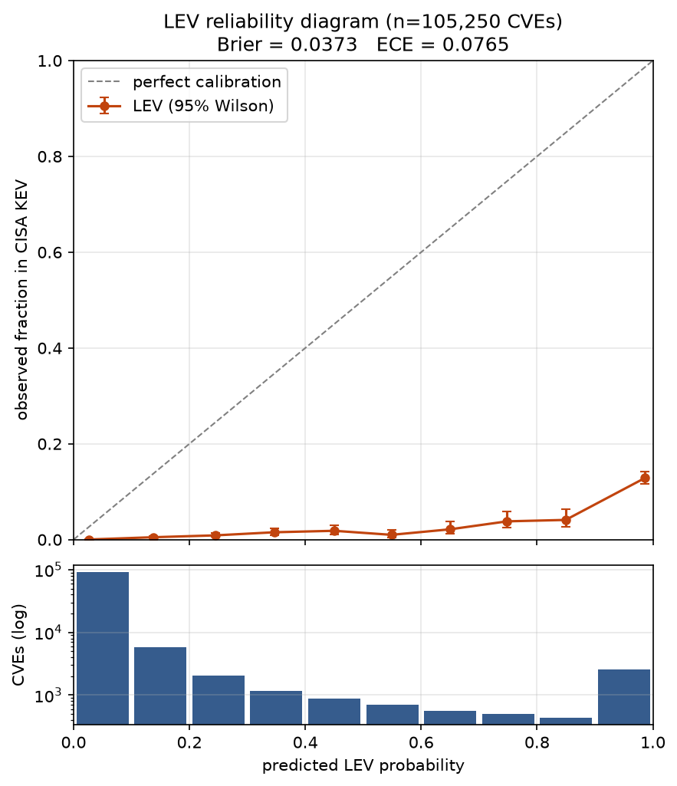
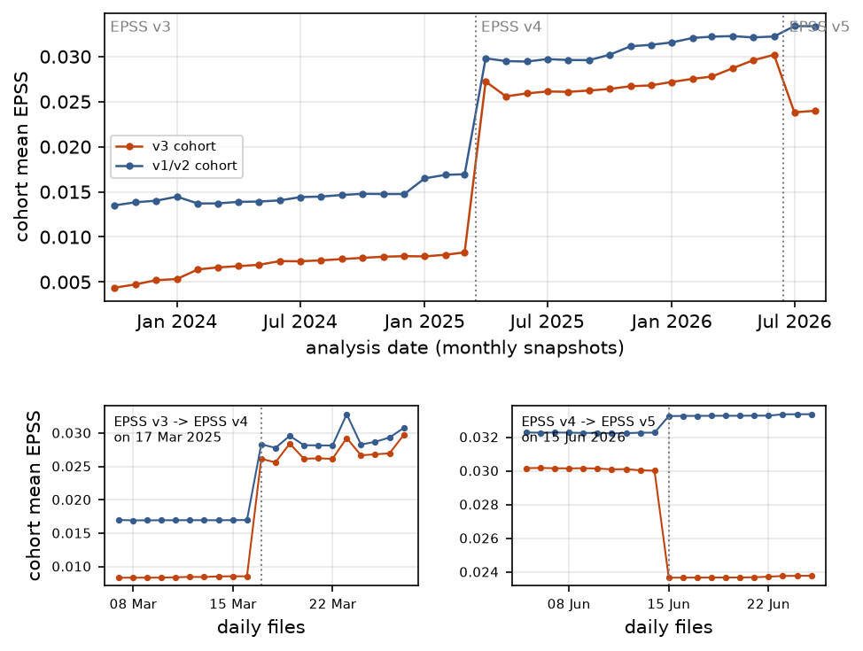
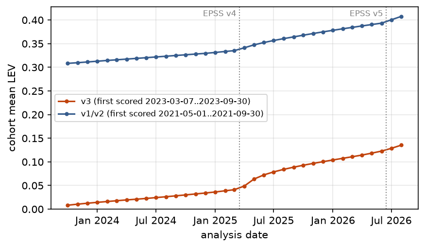
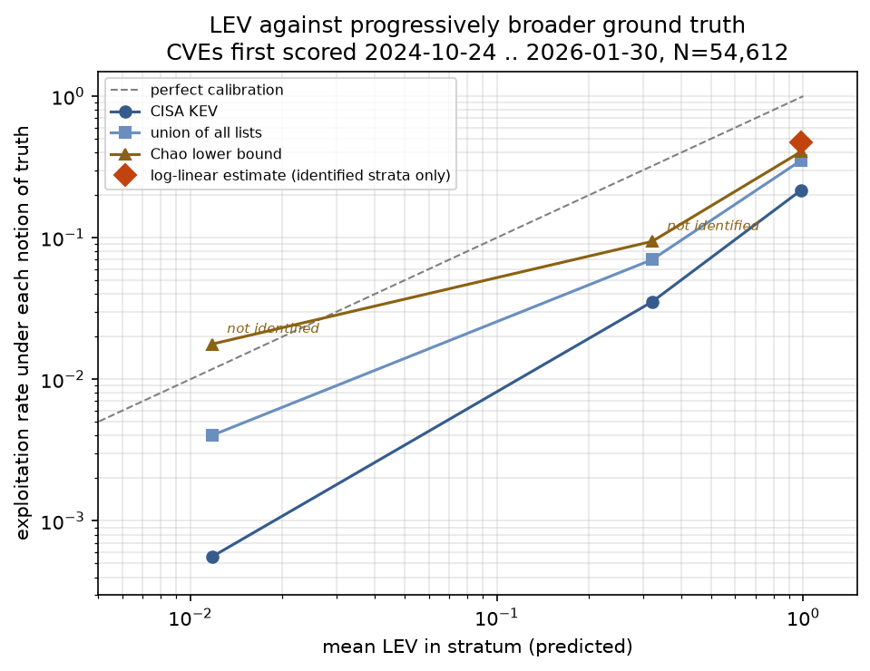
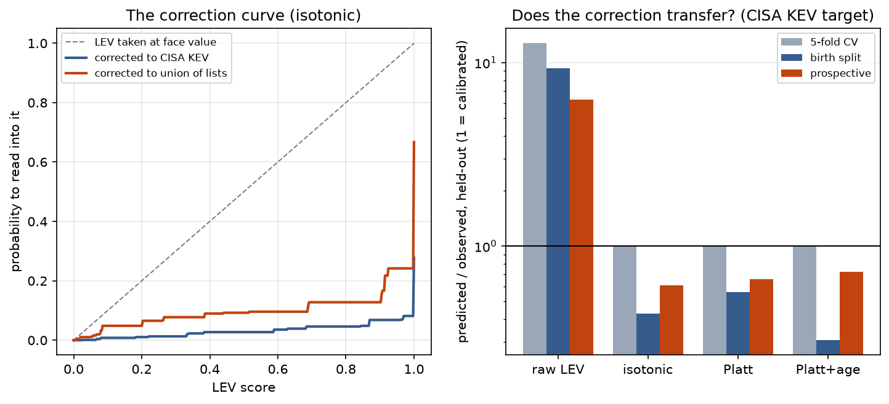

# Abstract

NIST's Cybersecurity White Paper 41 proposed Likely Exploited Vulnerabilities
(LEV), a probability that a CVE has already been exploited, computed by
compounding a CVE's history of EPSS scores. The white paper proposed using LEV
to find exploited vulnerabilities missing from CISA's Known Exploited
Vulnerabilities (KEV) catalogue, and noted that measuring its performance would
need outside data. We report what we believe is the first empirical evaluation
of LEV. We reimplement the metric, reproduce all four average-LEV values the
white paper publishes to within 11%, and test its calibration on 105,250 CVEs.
Against KEV, LEV over-predicts by 17.2x. Most of that gap has causes other than
LEV's core logic. EPSS was retrained during the observation window, and one
retraining tripled cohort scores overnight; 26.9% of LEV's probability mass is
this version artifact. LEV also grows without saturating as the analysis date
advances, contrary to the white paper's premise that EPSS decays for old CVEs.
To separate LEV's error from KEV's incompleteness we estimate, with
capture-recapture methods over three exploitation lists, how much exploitation
no list recorded. By counting alone, 30-58% of the over-prediction measured
against KEV is catalogue incompleteness. Where the estimate is identified
(LEV >= 0.9), LEV still over-predicts true exploitation by about 2x. A
monotone correction fitted one year earlier cuts calibration error 11-17x on
CVEs it never saw, but drifts, because the same LEV means different things at
different CVE ages.

# 1 Introduction

Defenders cannot patch everything, so they rank. Two public resources dominate
that ranking. The Exploit Prediction Scoring System (EPSS) gives each CVE a
daily probability of exploitation in the next 30 days [2, 3]. CISA's Known
Exploited Vulnerabilities catalogue (KEV) lists CVEs with confirmed
exploitation [4]. EPSS looks forward and KEV looks back; neither says how
likely it is that a given CVE has *already* been exploited without anyone
recording it.

Mell and Spring proposed LEV to fill that gap [1]. LEV treats each 30-day EPSS
score as the probability of exploitation in that window and combines the
windows since the CVE first appeared:

$$\mathrm{LEV}(v, d_0, d_n) = 1 - \prod_{i}\bigl(1 - \mathrm{epss}(v, d_i)\cdot w(d_i, d_n)\bigr),$$

where $d_i = d_0 + 30i$ and $w$ is 1 for full windows and the remaining
fraction for the last one. The white paper suggests two uses: flagging
high-LEV CVEs absent from KEV as likely exploited, and measuring how complete
KEV is. It also states that assessing LEV's performance requires collaboration
with parties holding exploitation data [1]. We found no published evaluation
(Section 8).

The obvious evaluation compares LEV with KEV. It cannot separate two stories. If
LEV says 0.99 and the CVE is not in KEV, either LEV is wrong or KEV missed it,
and the second story is the one the white paper proposes LEV for. A
KEV-only evaluation therefore measures LEV's error and KEV's blindness
together, in unknown proportion.

We address this in two phases. Phase 1 evaluates LEV against KEV and takes the
measured gap apart into causes we can observe directly in EPSS data. Phase 2
adds independent exploitation lists and estimates, with capture-recapture
methods from epidemiology and human-rights statistics, the exploitation none
of them recorded. That estimate is what lets LEV's error be separated from
KEV's.

Our contributions:

1. **Reproduction and calibration.** We reimplement LEV, reproduce the white
   paper's four published average-LEV values to within 11%, and show that
   against KEV it over-predicts by 17.2x while still ranking CVEs into three
   distinguishable levels.
2. **EPSS version drift.** EPSS was retrained inside the observation window.
   Model version strings are build dates, not deployment dates; located by day,
   one retraining multiplied cohort scores 3.06x overnight. LEV compounds across
   such boundaries, and 26.9% of its probability mass is this artifact.
3. **No saturation.** For fixed cohorts LEV grows convexly with the analysis
   date and shows no sign of levelling off. Cohort EPSS rises rather than
   decays, contrary to the white paper's premise.
4. **Catalogue incompleteness, estimated.** After auditing candidate lists (two
   that appear independent of KEV contain all of it), we estimate true
   exploitation with log-linear capture-recapture models and a ladder of
   progressively stronger assumptions. Counting alone attributes 30-58% of the
   KEV-measured gap to catalogue incompleteness. At LEV >= 0.9, LEV still
   over-predicts estimated true exploitation about 2x.
5. **A validated correction.** We fit a monotone map from LEV to observed
   exploitation and validate it prospectively. It cuts calibration error 11-17x
   on unseen CVEs a year later but drifts, which exposes a further property of
   LEV: its meaning depends on CVE age.

All data snapshots, hashes and code are released, and one command regenerates
every number in this paper (Section 10).

# 2 Background

## 2.1 EPSS

EPSS is a gradient-boosted model that scores every published CVE daily with
the probability of exploitation activity in the following 30 days [2, 3]. Its
ground-truth labels come from intrusion-detection and honeypot telemetry
supplied by Fortinet, AlienVault OTX, the Shadowserver Foundation and GreyNoise
[3]. Its 1,477 input features include public exploit code (Exploit-DB, GitHub,
Metasploit), offensive tool templates (Nuclei and others), and membership of
public exploitation lists, among them CISA KEV [3]. Two facts about this matter
later. KEV is an *input* to EPSS, so a CVE's KEV listing can raise its later
EPSS scores. And the model is retrained periodically, which can move every
score in the corpus at once.

## 2.2 LEV

LEV is the equation in Section 1, applied from the CVE's first EPSS date $d_0$
to an analysis date $d_n$. Each 30-day window takes the EPSS score on its
first day. The white paper also defines LEV2, which uses every daily score with
each converted to a one-day probability. Because LEV is a product over windows
it cannot decrease as $d_n$ advances. The white paper argues the growth should
stall because EPSS scores for old, unexploited CVEs decay toward zero [1].

## 2.3 KEV

CISA maintains KEV under Binding Operational Directive 22-01 [4]. An entry
requires reliable evidence of exploitation, an assigned CVE and clear
remediation guidance. `dateAdded` records when CISA catalogued the CVE, not
when exploitation began. KEV is selective by design: it serves federal
remediation priorities rather than aiming at complete coverage.

# 3 Data

**EPSS.** We use 67 monthly snapshots (the first of each month, plus the dates
Table 5 of [1] anchors on) from 2021-04-14 to 2026-08-01: 14,456,555 scores for
367,311 CVEs. A further 171 daily files serve two checks: they locate retraining
dates, and they bound the error from monthly sampling (Section 7).

**CISA KEV.** catalogVersion 2026.08.25, 1,676 entries. 1,665 have EPSS data;
the other 11 were never scored and cannot receive a LEV value.

**CVE List v5.** Release `cve_2026-08-25_1700Z`, 192,054 records from 2022
onward, for CVSS, CWE and vendor.

**Exploitation lists for Phase 2.** The CIRCL Vulnerability-Lookup service
publishes "exploited" sightings with the source of each [5]. We retrieved all
68,191 on 2026-09-28 and classified each by its source (Section 4.6). We also
retrieved ENISA's EU Vulnerability Database known-exploited dump, 1,740 entries
that name their source catalogue [6].

**Analysis population.** Unless stated otherwise, LEV is computed at
$d_n$ = 2026-08-01. The calibration cohort is the 105,250 CVEs first scored in
the EPSS v3 era (from 2023-03-07), at least six months before $d_n$ so each had
time to reach KEV. We exclude CVEs that EPSS backfilled: when EPSS v2 launched
on 2022-02-04 its coverage jumped from 80,800 to 168,325 CVEs, most of them old,
and taking first-EPSS date as a publication proxy would count them as new. A
CVE is kept only if EPSS first scored it within one calendar year of its CVE-ID
year. 495 cohort CVEs are in KEV, a base rate of 0.47%.

**Provenance.** Every fixed file is recorded with its SHA-256. Sources served
from moving branches or live APIs (Exploit-DB, Metasploit, CIRCL, EUVD) are
snapshotted and committed with the code rather than re-fetched.

# 4 Methods

## 4.1 Reimplementation and reproduction

We implement LEV exactly as specified. When a window starts on a date we do
not hold, we take the next available snapshot, as NIST's own implementation
does. We
compare the average LEV of CVEs published since each date in Table 5 of [1]
with the published values, at $d_n$ = 2025-03-01, close to the white paper's
own analysis date, which it does not state. LEV grows with $d_n$, so the date
matters: at $d_n$ = 2026-08-01 the first row overshoots by 296%.

## 4.2 Calibration

We bin the cohort into ten LEV buckets and compare each bucket's mean LEV with
the fraction of its CVEs in KEV, with Wilson score intervals [7] for the
observed rates. Adjacent buckets are compared with Fisher's exact test under
Holm correction [8]. We report the Brier score [9] and expected calibration
error (ECE) over the same ten bins [10].

## 4.3 Version normalization

To remove score shifts caused by EPSS retraining, we map every score produced
after the 2025-03-17 retraining back onto the preceding model's scale. Each
score keeps its percentile within its own day's file, and we substitute the
score at that percentile in the last pre-retraining file (2025-03-16). This
removes corpus-wide shifts. It cannot separate them from genuine per-CVE
improvement in the newer model, so normalized LEV is a lower bound on a
correction, not a corrected value.

## 4.4 Analysis-date sweep

For two fixed cohorts (13,685 CVEs first scored March-September 2023, and 7,558
first scored May-September 2021) we compute LEV at every month from 2023-10-01
to 2026-08-01 and fit six growth families: linear, logarithmic, saturating,
quadratic, exponential and power law. We compare them by AIC over the full
sweep and within the longest stretch with no retraining.

## 4.5 Circularity

Because KEV is an EPSS input, we test how much listing moves scores, with two
designs that cannot select on the outcome. First, for each KEV CVE we compare
EPSS in the last snapshot before `dateAdded` with the first snapshot on or
after it, net of non-KEV CVEs in the same starting-score decile over the same
pair of snapshots. Pairs that straddle a retraining are excluded. Second, we
compute each KEV member's LEV using only scores dated before its listing, which
the listing cannot have influenced.

## 4.6 Capture-recapture

**Lists.** An exploitation list is a set of CVEs a source records as exploited
in the wild. We consider three:

- CISA: CISA KEV.
- SENSOR: CIRCL sightings sourced from Shadowserver's honeypot feed (969 CVEs),
  which detects attempted exploitation directly.
- SOCIAL: CIRCL sightings from Telegram and similar channels (2,396 CVEs).

We audited every candidate for overlap with CISA KEV before use. CIRCL's
aggregated KEV catalogue contains all 1,676 CISA KEV CVEs, and VulnCheck's KEV
includes CISA KEV by its own documentation [11]; either used as a "second list"
makes the overlap equal to CISA KEV by construction. We exclude the first and,
lacking an API token, could not rebuild the second from its per-report sources.
EU KEV lists 66 CVEs; 55 are also on CISA KEV, and 88% of those carry CISA's
own date, so we treat it as derivative. Exploit-DB records exploit
availability rather than exploitation and is excluded as a list.

**Population.** SENSOR begins on 2024-10-24. We restrict to the 54,612 CVEs
first scored between 2024-10-24 and 2026-01-30, so every list could observe
every CVE from its first score, and apply the six-month maturity rule. 570 of
these appear on at least one list.

**Models.** Two-list estimates disagree by 2.4x (530 to 1,256), so the lists
are not independent and dependence has to be modelled. We fit Poisson
log-linear models to the seven observable capture patterns under every
hierarchical structure of two-way interactions, assume no three-way
interaction (the standard identifying assumption [12, 13]), select by AIC, and
bootstrap a 95% interval from the fitted cell means. Chao's estimator [14],
a lower bound that stays valid under heterogeneous capture probabilities, is
reported alongside.

**When not to report an estimate.** Log-linear estimates of the unseen cell can
be driven entirely by the choice of interaction terms. We declare a population
not identified, and report no point estimate, if models within 2 AIC of the
best disagree by more than 2x [15], if the estimate exceeds the population, or
if it falls below the lower end of Chao's interval.

**The truth ladder.** Rather than one estimate, we report LEV's over-confidence
(mean LEV over the exploitation rate) against successively stronger notions of
truth, each adding one assumption: KEV alone; KEV or SENSOR; the union of all
three lists; the two-list Chapman estimate; Chao's bound; the log-linear
estimate. Every rung is a lower bound on, or an estimate of, the number
exploited, so every over-confidence figure is an upper bound on LEV's error. A
reader can stop at whichever assumption they accept.

## 4.7 Correction curve

We fit a monotone map from LEV to observed exploitation by isotonic regression
[16] and by Platt scaling [17], and a Platt variant that also takes log CVE age.
There are two targets: KEV on the calibration cohort, and the union of the
three lists on the Phase 2 population. All scores are on held-out CVEs, under
three schemes. Five-fold cross-validation is the in-distribution case. A split
by first-score date trains on older CVEs and tests on newer ones. The deciding
scheme is prospective: the map is fitted at $d_n$ = 2025-08-01 with outcomes
known then, and applied at 2026-08-01 to the 44,316 CVEs first scored after the
training cohort, none of which it saw.

# 5 Results

## 5.1 The reimplementation reproduces the white paper

| CVEs published since | CSWP 41 | ours | difference |
|---|---|---|---|
| 2023-03-07 | 0.015 | 0.0162 | +8% |
| 2022-02-04 | 0.047 | 0.0479 | +2% |
| 2021-04-14 | 0.087 | 0.0838 | -4% |
| all CVEs | 0.146 | 0.1299 | -11% |

Table 1: Average LEV at $d_n$ = 2025-03-01 against Table 5 of [1].

All four values fall within 11%. The fourth row matches only with the backfill
correction of Section 3; without it we get 0.255 (+75%). This validates the
implementation. It does not validate the metric, and the agreement is specific
to the analysis date.

## 5.2 Against KEV, LEV over-predicts 17.2x but ranks

Across the 105,250-CVE cohort, mean LEV is 0.081 against a KEV rate of 0.0047:
LEV over-predicts by 17.2x (Brier 0.0373, ECE 0.0763). The observed rate climbs
from 0.03% in the lowest LEV bucket to 12.9% in the highest, where LEV averages
0.987 (Figure 1). Only two of the nine adjacent-bucket differences survive Holm
correction, those at either end. LEV separates three levels (low, middle,
high) rather than ten.

## 5.3 EPSS retraining puts an artifact into LEV

EPSS's model version strings are build dates. Version v2025.03.14 first appears
in the file for 2025-03-17. On an unchanged set of 13,552 CVEs, cohort mean
EPSS goes from 0.00862 on 2025-03-16 to 0.02640 the next day, a 3.06x step
(Figure 2). Anyone bracketing by the version string measures
almost no change. Of the rise in cohort EPSS over 2023-2026, 64% (v3 cohort)
and 70% (v1/v2 cohort) happens at retraining boundaries rather than between
them.

LEV multiplies scores across these boundaries as if they belonged to one
measurement series. When post-retraining scores are mapped back to the v3
scale (Section 4.3), mean LEV drops by 26.9%, and over-prediction against KEV falls
from 17.2x to 12.6x (Brier 0.0288, ECE 0.0546). Version mixing accounts for
part of the gap but leaves most of it. Normalization also moves three of the
four Table 5 values toward the published figures at $d_n$ = 2026-08-01
(mean absolute deviation 102% to 63%), without ever seeing them; the fourth,
which spans pre-v3 models, moves away.

## 5.4 LEV grows without saturating

For the 2023 cohort, mean LEV rises from 0.008 to 0.135 between October 2023
and August 2026 (Figure 3). A quadratic fits better than linear, logarithmic or
saturating growth, both over the full sweep and within the retraining-free
stretch (AIC margin 12.8 over linear there), and the preference survives
version normalization. Monthly increments grow rather than shrink. The premise
behind the expected slowdown fails as well: cohort mean EPSS rises from 0.0044
to 0.0240 rather than decaying. If this continues, the share of the cohort
above LEV 0.9 roughly doubles by 2028, and LEV loses discrimination as more of
the corpus approaches 1.

Monotone growth is a property of the equation, not a finding. The empirical
content is the shape: no saturation within 35 months, and no evidence of the
decay the white paper relies on.

## 5.5 High LEV mostly follows KEV listing

At the listing date, the median KEV CVE's EPSS does not move relative to
matched non-KEV controls, but a quarter of listed CVEs rise at least 2.85x more
than their controls. The KEV input feature matters for a sizeable minority of
listings rather than all of them.

The second test bears on the white paper's proposed use. 56% of cohort KEV
members were listed in the same month EPSS first scored them, so LEV could not
have flagged them first. Of the 220 with a pre-listing history (a median of 2.8
months), 15% had LEV >= 0.5 before CISA listed them, and the median was 0.005;
after listing the median is 1.0. Part of that gap is elapsed time, since
pre-listing LEV covers fewer windows. Either way, among the CVEs KEV did list,
high LEV mostly arrived after the listing. This tells against using LEV as a
leading indicator of KEV listing, and it means the high-LEV bucket's KEV
concentration in Section 5.2 is partly circular.

## 5.6 How much of the gap is the catalogue's

Table 2 gives the truth ladder on the 54,612-CVE Phase 2 population, where KEV
alone gives 7.91x.

| truth | assumption added | exploited | over-confidence |
|---|---|---|---|
| CISA KEV | KEV is complete | 236 | 7.91x |
| CISA or SENSOR | honeypot sightings are real | 336 | 5.56x |
| union of three lists | every sighting is real | 570 | 3.28x |
| Chapman (CISA, SENSOR) | these two lists independent | 730 | 2.56x |
| Chao lower bound | closed population | 887 | 2.11x [1.89, 2.31] |
| log-linear, AIC-selected | no three-way interaction | 1,896 | 0.98x [0.59, 1.38] |

Table 2: LEV over-confidence against successively stronger notions of truth.
Intervals are 95%.

If only KEV and honeypot sightings are trusted, over-prediction falls from
7.91x to 5.56x. If all three lists are trusted, it falls to 3.28x. So by counting alone, with
no model, 30-58% of the gap measured against KEV is catalogue incompleteness;
under Chao's bound it is at least 73%. Equivalently, KEV recorded at most 41%
of the exploited CVEs that any list observed in this population, and at most
27% under Chao's bound.

We report but do not claim the bottom rung. It pools strata that the
stratified analysis rejects as heterogeneous, and the lowest stratum is
dominated by sightings we cannot vouch for. Table 3 and Figure 4 stratify by LEV.

| LEV | N | union | Chao | log-linear |
|---|---|---|---|---|
| [0.0, 0.1) | 52,019 | 2.93x | 0.66x | not identified: below Chao's bound |
| [0.1, 0.9) | 1,957 | 4.59x | 3.41x | not identified: models span 143 to 2,997 |
| [0.9, 1.0] | 636 | 2.80x | 2.42x | 2.07x [1.75, 2.46] |

Table 3: Over-confidence by LEV stratum.

Only the top stratum supports an estimate. There LEV averages 0.985, and we
estimate 47% [40%, 56%] of those CVEs were exploited. Every rung above
counting agrees on 2.1-2.4x. The middle stratum's best models tie on AIC while
implying anywhere from 143 to 2,997 exploited CVEs, more than the stratum
holds, and three lists cannot choose between them. In the lowest stratum 86% of
the CVEs seen by exactly one list were seen only on Telegram, where actors also
post mass lists of CVEs they claim to use; the model estimate falls below
Chao's bound there, and we do not report it.

Two checks. Shadowserver is one of EPSS's label sources, so EPSS is trained to
predict roughly what SENSOR records. Without SENSOR, over-confidence is 3.85x
against the union and 2.71x against Chao's bound: LEV looks somewhat worse
without the list it was trained toward, as expected, and the conclusion
holds. Second, the listing boost of Section 5.5 lifts some KEV members into the
top stratum. Those CVEs are true positives, so without the boost the top
stratum's exploited share would likely be lower, and the 2x figure is probably
conservative.

## 5.7 A correction curve, and why it drifts

| method | Brier | ECE | predicted / observed |
|---|---|---|---|
| raw LEV | 0.0112 | 0.0229 | 6.28x |
| isotonic | 0.0036 | 0.0020 | 0.61x |
| Platt | 0.0037 | 0.0015 | 0.66x |
| Platt with CVE age | 0.0036 | 0.0014 | 0.72x |

Table 4: Prospective validation against KEV. Fitted at 2025-08-01; scored at
2026-08-01 on 44,316 CVEs the fit never saw.

Under cross-validation any of the three maps restores calibration (predicted
over observed 1.00-1.01x). Prospectively, each cuts calibration error 11-17x,
but all under-predict by 28-39% a year later. Against the union target,
isotonic regression transfers almost exactly (0.95x; ECE 0.0163 to 0.0021;
Figure 5).

The drift has a cause we can name. An old CVE reaches a given LEV through many
windows of modest EPSS, and a new one through a few high scores. The second is
stronger evidence, so the same LEV value carries a different probability at
different ages. A Platt model that also takes log age recovers about a
quarter of the drift. This is the non-saturation of Section 5.4 seen from another side:
LEV's scale depends on how long it has been accumulating.

| LEV | corrected to KEV | corrected to union of lists |
|---|---|---|
| 0.10 | 0.8% | 4.9% |
| 0.50 | 2.7% | 9.2% |
| 0.90 | 6.8% | 12.8% |
| 0.99 | 8.2% | 24.2% |
| 1.00 | 27.8% | 66.7% |

Table 5: The isotonic correction, fitted on all data. Both targets are
catalogue appearance and so are lower bounds on true exploitation.

# 6 Discussion

**What LEV is good for.** LEV ranks. Its extremes separate: the top bucket's
KEV rate is nearly 500 times the bottom bucket's. Its values should not be
read as probabilities. A LEV of 0.9 corresponds to about 7% chance of KEV
listing and about 13% chance of appearing on any of our three lists.

**What LEV is not good for yet.** The white paper proposes LEV for finding
exploited CVEs that KEV misses. Our results cut both ways on that. LEV's
apparent over-confidence is substantially KEV's incompleteness, which is the
premise of the proposal. But among CVEs KEV did list, high LEV mostly came
after the listing, so LEV did not anticipate them.

**What would make LEV more reliable.** Four changes follow from the results.
Compute LEV within a single EPSS model version, or normalize across versions,
since retraining otherwise enters as evidence. State the analysis date with
every published LEV value, since values are not comparable across dates. Stop
accumulating, or decay, windows for CVEs with no recent evidence, or accept
that LEV drifts toward 1. And validate against more than KEV: KEV is both an
EPSS input and incomplete.

**KEV coverage.** Empirical Security reports that KEV covers at most about 8.7%
of CVEs with observed exploitation activity, from proprietary telemetry [18].
Our bounds are upper bounds on coverage, from open data, on a younger
population: at most 41% by counting, at most 27% under Chao's bound, and 12%
[7%, 18%] from the pooled model we do not claim. The directions agree. The
levels differ as they should, since our lists are fewer and narrower than one
vendor's full telemetry.

# 7 Threats to validity

We record 51 threats in the released repository. The ones that bear most on
the conclusions:

- **Monthly sampling.** LEV's windows are 30 days and our snapshots are about
  30.4 days apart. On 479 CVEs stratified by LEV decile, LEV from true daily
  windows differs from ours by 3.9% of mean LEV (population-weighted), with no
  consistent sign. The check covers the calibration cohort, not the older CVEs
  behind the Table 5 rows.
- **Publication-date proxy.** We use first EPSS appearance as publication date,
  with a backfill filter. Without the filter, Table 5's "all CVEs" row misses by
  75%.
- **Circularity.** KEV is an EPSS input (Section 5.5), and Shadowserver is an
  EPSS label source. We measure the first and drop the second as a check; we
  cannot remove either from EPSS.
- **List dependence.** The log-linear model assumes no three-way interaction,
  which three lists cannot test. We report estimates only where identified.
- **False sightings.** Telegram sightings include claims we cannot verify. Every
  headline figure is also given with that list excluded.
- **A short, young population.** SENSOR starts in October 2024, so Phase 2
  covers CVEs first scored over 15 months, each observed for 6-21 months.
- **Normalization.** Percentile mapping removes corpus-wide shift and cannot
  separate it from genuine improvement in the newer model.
- **KEV dates.** `dateAdded` is a cataloguing date. Timing comparisons are
  lagged by an unknown amount.
- **Search scope.** Our search for prior work was targeted, not systematic.

# 8 Related work

**EPSS and its evaluation.** EPSS was introduced by Jacobs et al. [2] and
extended with a larger feature set in version 3 [3]. Parla evaluates EPSS on
high-severity CVEs in KEV [19]. These works evaluate the forward-looking score;
none evaluates LEV.

**LEV.** Beyond the white paper [1], an independent reimplementation by the
Risk Based Prioritization project questions LEV's small-probability
approximation and its independence assumption, and disputes the white paper's
reading of EPSS for previously exploited CVEs [20]. It does not validate LEV
against exploitation data. We found no empirical evaluation of LEV in arXiv
or the security literature up to September 2026.

**Prioritization with KEV as ground truth.** Recent frameworks combine CVSS,
EPSS and KEV [21] or build composite risk indicators evaluated on KEV [22].
ThreatLens trains a ranking model on KEV entries as weak supervision [23]. Our
results suggest caution with any of these: KEV is incomplete in a
vendor-dependent way, and it is already an EPSS input. Shaffer and Voicu model
exploitation hazard with a decay calibrated on KEV timing [24]; our cohorts
show EPSS rising, not decaying, over 35 months.

**Multiple-systems estimation.** Capture-recapture over administrative lists is
standard in epidemiology [12] and has been used to estimate casualties and
modern slavery, where its sensitivity to list dependence and sparse cells is
well documented [25]. We found no prior application to vulnerability
exploitation.

# 9 Conclusion

Evaluated against KEV, LEV looks badly over-confident. Much of that is not
LEV's doing. EPSS retraining puts an artifact into the product LEV computes,
LEV accumulates without the saturation its design assumes, and KEV records a
minority of the exploitation that other lists observe. Where exploitation can
be estimated, at the top of LEV's scale, LEV still over-predicts about twofold.
A monotone correction brings its values much closer to observed rates, but has
to be refitted as CVEs age.

A fourth independent list would identify the middle of LEV's scale, where
three lists cannot. VulnCheck's KEV, rebuilt without CISA-sourced evidence, is
the natural candidate; the released code includes it once an access token is
supplied.

# 10 Data and code availability

[Repository URL]. `make fetch` downloads the fixed inputs and `make reproduce`
regenerates every table and figure. SHA-256 hashes, release tags and retrieval
dates for all inputs are listed in `DATA_SNAPSHOT.md`.

# References

See `references.md` for full entries and verification status.

[1] P. Mell and J. Spring. Likely Exploited Vulnerabilities: A Proposed Metric for Vulnerability Exploitation Probability. NIST CSWP 41, May 2025.
[2] J. Jacobs, S. Romanosky, B. Edwards, I. Adjerid, M. Roytman. Exploit Prediction Scoring System (EPSS). Digital Threats: Research and Practice 2(3), 2021.
[3] J. Jacobs, S. Romanosky, O. Suciu, B. Edwards, A. Sarabi. Enhancing Vulnerability Prioritization: Data-Driven Exploit Predictions with Community-Driven Insights. arXiv:2302.14172, 2023.
[4] CISA. Known Exploited Vulnerabilities Catalog; BOD 22-01.
[5] CIRCL. Vulnerability-Lookup, sightings API.
[6] ENISA. EU Vulnerability Database API.
[7] E. B. Wilson. Probable inference, the law of succession, and statistical inference. JASA 22(158), 1927.
[8] S. Holm. A simple sequentially rejective multiple test procedure. Scand. J. Statistics 6(2), 1979.
[9] G. W. Brier. Verification of forecasts expressed in terms of probability. Monthly Weather Review 78(1), 1950.
[10] M. P. Naeini, G. Cooper, M. Hauskrecht. Obtaining well calibrated probabilities using Bayesian binning. AAAI 2015.
[11] VulnCheck. VulnCheck KEV documentation.
[12] International Working Group for Disease Monitoring and Forecasting. Capture-recapture and multiple-record systems estimation I. Am. J. Epidemiology 142(10), 1995.
[13] Y. M. M. Bishop, S. E. Fienberg, P. W. Holland. Discrete Multivariate Analysis. MIT Press, 1975.
[14] A. Chao. Estimating the population size for capture-recapture data with unequal catchability. Biometrics 43(4), 1987.
[15] K. P. Burnham and D. R. Anderson. Model Selection and Multimodel Inference, 2nd ed. Springer, 2002.
[16] B. Zadrozny and C. Elkan. Transforming classifier scores into accurate multiclass probability estimates. KDD 2002.
[17] J. Platt. Probabilistic outputs for support vector machines and comparisons to regularized likelihood methods. Advances in Large Margin Classifiers, 1999.
[18] M. Roytman. The KEV Paradox. Empirical Security, 2026.
[19] R. Parla. Efficacy of EPSS in High Severity CVEs found in KEV. arXiv:2411.02618, 2024.
[20] Risk Based Prioritization project. NIST LEV. riskbasedprioritization.github.io/epss/LEV.
[21] N. Shimizu and M. Hashimoto. Vulnerability Management Chaining. arXiv:2506.01220, 2025.
[22] E. Sherif, I. Yevseyeva, V. Basto-Fernandes, A. Cook. Bridging the Gap Between Security Metrics and Key Risk Indicators. arXiv:2603.12450, 2026.
[23] S. Motamedi Sedeh et al. ThreatLens: Evidence-Guided Ranking of High-Priority CVEs. arXiv:2608.22306, 2026.
[24] S. Shaffer and L. Voicu. Modeling Local Exploit Hazard. arXiv:2607.24618, 2026.
[25] O. Binette and R. C. Steorts. On the Reliability of Multiple Systems Estimation for the Quantification of Modern Slavery. J. Royal Statistical Society Series A, 2022. arXiv:2112.01594.
