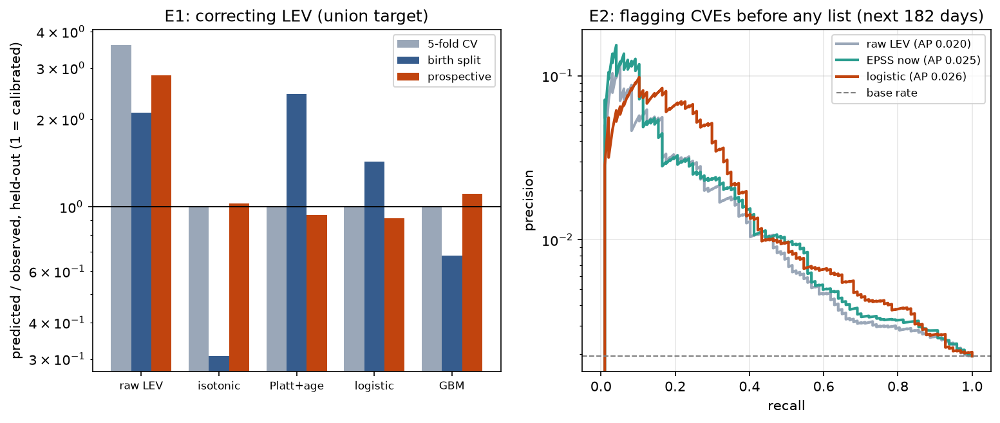

# Draft insert: a learned alternative to LEV's compounding rule

> **WARNING (2026-10-11): do not merge this as written.** A robustness check
> (dropping CISA-KEV-listed CVEs from the Experiment 1 target) removes the
> learned model's advantage over LEV and reverses it against current EPSS, so
> the E1 headline, the "peak EPSS" interpretation and the Discussion item below
> are circularity artifacts. Also: LEV is additive on the log-survival scale,
> not the logit scale; `learned_lev.py` uses raw LEV while §5.7 uses
> version-normalized LEV. See `PROJECT-REVIEW.md` §9 for what survives.

Status: draft for review, not yet merged into `draft.md`. Every number below
comes from `python analysis/learned_lev.py` (output in
`results/learned_lev.json`, figure `figures/learned_lev.png`). Merge points are
marked **[→ §x]**.

---

## Why this model, and not a classifier

The report's "Why there is no model" argues against a classifier on four
grounds. This model is designed to meet each one, not to wave them away:

| Objection | How the design meets it |
|---|---|
| Wrong question: a better predictor does not test LEV | The model sees **only LEV's own inputs**, a CVE's EPSS history. No CVSS, CWE, vendor or exploit-code features. Holding information fixed and changing only the aggregation rule turns the model into a test of LEV's rule. |
| Broken labels: KEV is incomplete | The primary target is the **union of the three evidence-citing lists**; KEV is secondary. Under the selected-completely-at-random assumption, a classifier trained on incomplete positives ranks exactly as one trained on the truth, and its probabilities are a fixed fraction of the true ones [27]. Ranking metrics therefore stay valid; probabilities are lower bounds, like every rung of the truth ladder. |
| Circularity: KEV is an EPSS input | Experiment 2 is **forward**: features use EPSS dated ≤ t, CVEs already on any list at t are excluded, and the label is first listing after t. A listing cannot raise scores dated before it. |
| It would just reproduce EPSS | Current EPSS is a **baseline the model must beat**, not a hidden input. |

Temporal design follows the security-ML pitfalls literature: no test row's
label window overlaps a training row's, and the deciding test always trains on
the past and scores the future [28, 29].

---

## 4.8 Learned aggregation **[→ new §4.8, after §4.7]**

LEV aggregates a CVE's EPSS history with a fixed rule: multiply the 30-day
survival probabilities. We ask whether a model that sees the same history, but
learns how to aggregate it, does better. If it does, part of LEV's error lies
in the rule (independence across windows, compounding across retrainings, no
decay), not in the information EPSS carries.

**Features.** Eight, all computed from EPSS snapshots dated on or before the
analysis date: LEV itself, log CVE age, and the CVE's current, peak, mean and
first EPSS, its three-month trend, and the number of EPSS retrainings its
history crosses.

**Models.** The primary model is L2-regularized logistic regression with the
probability features on the logit scale, where LEV's compounding is additive;
it is LEV with learned weights in place of fixed ones. A gradient-boosted tree
model, constrained to be monotone in LEV and heavily regularized, checks
whether a more flexible learner finds anything a linear one misses.

**Experiment 1 (correction).** The populations, targets and three validation
schemes of §4.7, unchanged, with both models added beside isotonic regression
and the age-aware Platt model.

**Experiment 2 (leading indicator).** At t = 2025-08-01 we take every CVE in
the Phase 2 population with at least a month of EPSS history and not yet on
any primary list, compute features at t, and label it positive if it first
appears on a list in the next 182 days. The models are fitted on these and
applied at t = 2026-01-30, whose label window (to 2026-08-01) starts where the
training window ends. We score average precision (AP), precision and recall
among the top 1% of CVEs, and calibration, with 95% bootstrap intervals (500
resamples) on AP differences.

---

## 5.8 LEV's rule loses information, but nothing anticipates the lists **[→ new §5.8]**

**A re-weighted LEV ranks better and stays calibrated a year ahead.** Table 7
gives the prospective test of §5.7 with the learned models added.

| method | union: pred/obs | union: AP | KEV: pred/obs | KEV: AP |
|---|---|---|---|---|
| raw LEV | 2.83x | 0.397 | 8.81x | 0.341 |
| current EPSS | 0.73x | 0.404 | 2.28x | 0.456 |
| isotonic | 1.02x | 0.349 | 0.62x | 0.311 |
| Platt with CVE age | 0.94x | 0.372 | 0.82x | 0.337 |
| **logistic (learned)** | **0.91x** | **0.435** | **0.94x** | **0.439** |
| gradient-boosted trees | 1.11x | 0.313 | 1.60x | 0.251 |

Table 7: Prospective validation. Fitted at 2025-08-01, scored at 2026-08-01 on
44,316 CVEs the fit never saw. Union of primary lists: 111 training positives;
KEV: 288.

Against the union of the primary lists, the logistic model ranks better than
raw LEV (AP +0.038, 95% interval +0.019 to +0.054), better than current EPSS
(+0.009 to +0.057) and better than the best correction of §5.7 (+0.038 to
+0.083), while staying calibrated (0.91x) with the lowest Brier score of any
method. Against KEV it again beats LEV (+0.048 to +0.153) and transfers better
than any correction curve (0.94x against 0.62-0.82x), but it does not beat
current EPSS (-0.061 to +0.023). That is the pattern circularity predicts:
once a CVE is listed, its current EPSS already knows it.

The gradient-boosted model is significantly worse than the logistic one
prospectively (union AP -0.100 to -0.142) although slightly better under
cross-validation. With 111 positives it fits the training year, not the
signal. There is nothing non-linear left for this much data to teach.

**What the model learns.** On the logit scale, the largest weight goes to a
CVE's *peak* EPSS (+1.03 per standard deviation on the union target, +1.76 on
KEV). LEV's own weight is small (+0.45) or negative (-0.22) once the peak is
known. The features are correlated, so single coefficients should not be read
causally. Together, though, they say the evidence sits in a CVE's highest score,
not spread evenly over its windows as LEV's product assumes. The retraining
count could not be tested here: every CVE in the training populations crosses
the same retraining, so the feature is constant.

**The age drift remains.** Across birth cohorts the logistic model still
drifts (1.43x on the union target, 0.36x on KEV), as do the curves of §5.7.
Learned weights do not remove the dependence of LEV's meaning on CVE age; they
only shrink the error that follows from it in a forward-in-time test.

**No aggregation anticipates the lists.** Experiment 2 removes circularity
entirely. Of 49,678 CVEs unlisted on 2026-01-30, 97 (0.20%) appear on a primary
list in the next six months.

| method | AP | precision in top 1% | recall in top 1% |
|---|---|---|---|
| raw LEV | 0.020 | 3.2% | 16.5% |
| current EPSS | 0.025 | 3.2% | 16.5% |
| Platt with CVE age | 0.035 | 4.6% | 23.7% |
| logistic (learned) | 0.026 | 5.2% | 26.8% |
| gradient-boosted trees | 0.012 | 2.2% | 11.3% |

Table 8: Forward test, union target. Features at 2026-01-30; outcome is first
listing by 2026-08-01. Trained one horizon earlier on 32,223 CVEs (71 positive).

Every method beats chance by 10-25x at the top of the ranking, and none is
usable as an early warning: the best flags one future listing in about 20
CVEs. No difference in AP is significant. Learned against LEV: -0.008 to
+0.020. Learned against EPSS: -0.017 to +0.014. EPSS against LEV: -0.001 to
+0.016. LEV's accumulated history adds nothing measurable to the current EPSS
score as a leading indicator, and a learned aggregation adds nothing to
either. Against KEV alone the forward test has 14 training and 17 test
positives and is too small to separate methods.

---

## Discussion additions **[→ §6, "What would make LEV more reliable"]**

Add as a fifth change: *weight the evidence rather than multiply it.* The same
EPSS history, re-weighted by a linear model with one weight per feature, ranks
exploited CVEs better than LEV and stays calibrated a year ahead. Its largest
weight falls on a CVE's peak score. A LEV variant built on the peak, or on
learned weights refitted yearly, would keep LEV's interpretability and lose
part of its error.

Replace the sentence on the white paper's proposed use with: *Neither LEV nor
any aggregation of EPSS history we tried anticipates which CVEs the lists will
record next; the signal that would find KEV's missing entries in advance is not
in EPSS history.*

## Threats additions **[→ §7]**

- **Snapshot circularity in Experiment 1.** KEV members are part of the union
  target, and listing raises later EPSS. The prospective gain over LEV could
  partly reflect that. Experiment 2 has no such path, and there the learned
  model's advantage is not significant. A union target without CISA KEV is the
  natural next check.
- **Small positive counts.** 111 union positives train the prospective model
  and 71 the forward one. Logistic regression was chosen as primary for this
  reason; the boosted model's collapse shows what overfitting costs here.
- **One forward split.** Experiment 2 uses a single six-month horizon; rolling
  origins would tighten its intervals once more months of SENSOR data exist.

## Related work addition **[→ §8, new paragraph "Learning exploitation"]**

Expected Exploitability learns the probability that a functional exploit will
be developed and tracks it over time [30]. Recent frameworks train classifiers
on EPSS and KEV directly (§8, [21-23]). We differ in what the model is for: it
is restricted to LEV's own information to test LEV's aggregation rule, it is
trained on lists audited for dependence rather than on KEV, and it is
validated forward in time, as the security-ML literature recommends [28, 29].
Positive-unlabeled learning [27, 31] gives the reason incomplete lists still
support a ranking evaluation, and capture-recapture (§4.6) supplies the label
frequency that PU methods otherwise have to assume.

## References to add

| # | Reference | Status |
|---|---|---|
| 27 | C. Elkan and K. Noto. *Learning Classifiers from Only Positive and Unlabeled Data.* KDD 2008, pp. 213-220. | verified 2026-10-11 |
| 28 | D. Arp, E. Quiring, F. Pendlebury, A. Warnecke, F. Pierazzi, C. Wressnegger, L. Cavallaro, K. Rieck. *Dos and Don'ts of Machine Learning in Computer Security.* USENIX Security 2022. | verified 2026-10-11 (authors from arXiv:2010.09470) |
| 29 | F. Pendlebury, F. Pierazzi, R. Jordaney, J. Kinder, L. Cavallaro. *TESSERACT: Eliminating Experimental Bias in Malware Classification across Space and Time.* USENIX Security 2019, pp. 729-746. | verified 2026-10-11 |
| 30 | O. Suciu, C. Nelson, Z. Lyu, T. Bao, T. Dumitras. *Expected Exploitability: Predicting the Development of Functional Vulnerability Exploits.* USENIX Security 2022, pp. 377-394. | verified 2026-10-11 |
| 31 | J. Bekker and J. Davis. *Learning from Positive and Unlabeled Data: A Survey.* Machine Learning 109(4):719-760, 2020. | verified 2026-10-11 |

## Other files that must change if this is merged

These still say no model is trained:

- `report/lev-report-print.html` line 482, section "Why there is no model":
  reframe it as "Why the model is restricted", keeping the four reasons and
  pointing to the table at the top of this file.
- `report/deck.js` lines 251-252: speaker note "This is the only model we fit".
- `PRESENTATION-GUIDE.md` line 131 ("the only model I trained, on purpose") and
  the Q&A answer at lines 153-157.
- Abstract and contributions list in `draft.md`: add one contribution, e.g.
  *"6. A learned aggregation. Re-weighting the same EPSS history beats LEV's
  product prospectively, but no aggregation of EPSS history anticipates the
  lists."*
